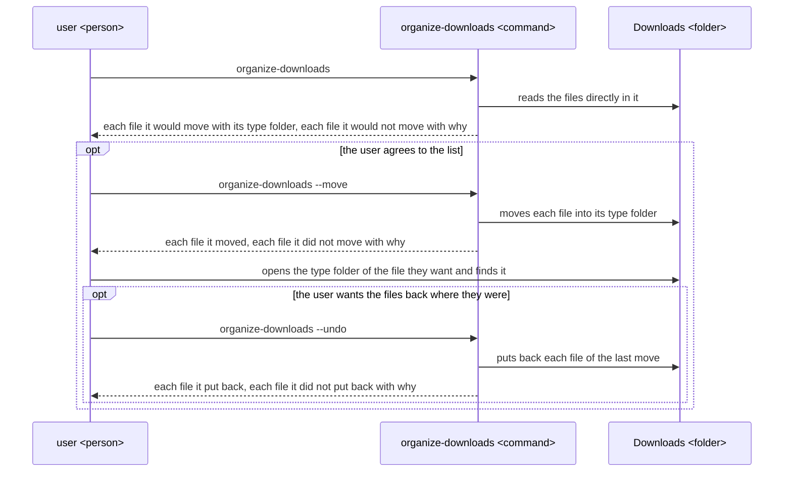
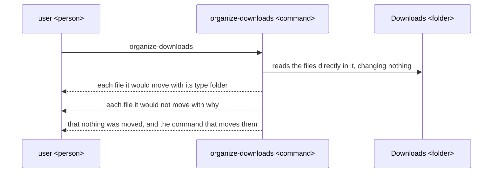
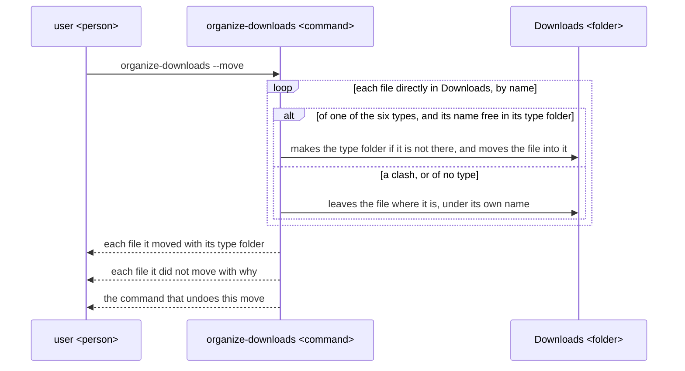
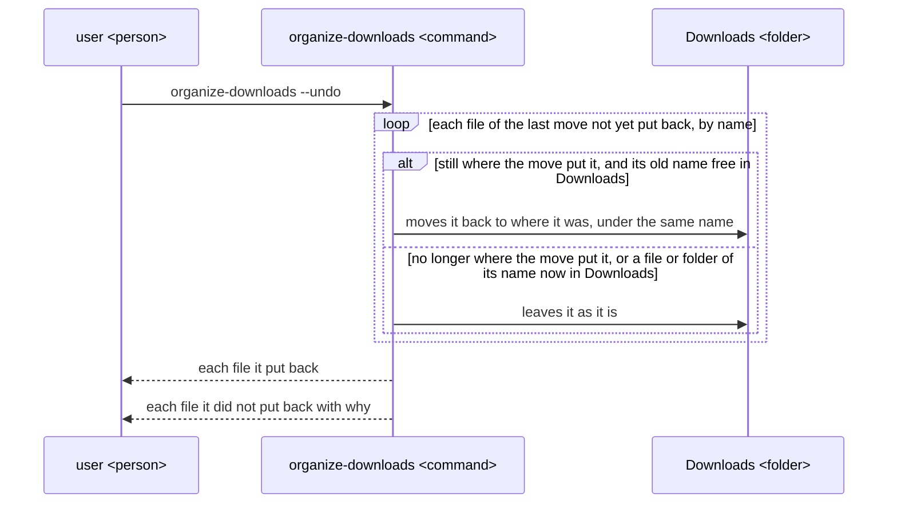
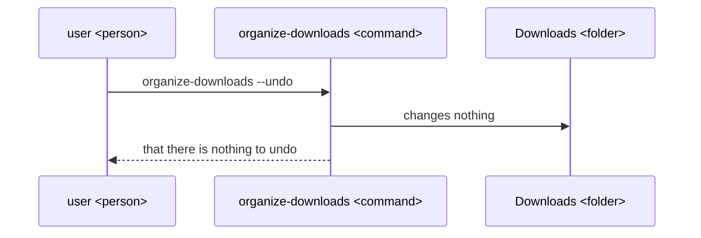
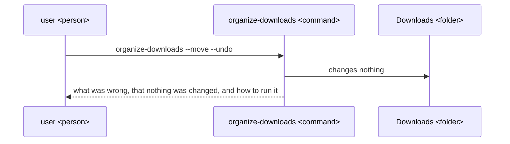

# organize-downloads UX

organize-downloads gives a person on macOS or Linux whose Downloads folder has piled up a way to sort its files into one folder per type, seeing first what would move, losing no file, and putting the files back with one command; the README, the architecture and the tool are all built to this UX.

## Users and goals

- G1: A person on macOS or Linux who downloads many files of mixed kinds and can type a command in a terminal wants to find a downloaded file by opening the one folder for its type, without losing or changing any file.

  Someone who never opens a terminal is not a user of this tool; someone who has, and whose Downloads folder holds more files than they can scan by eye, is.

## Key results

They stand from the highest priority: a file lost or changed costs the user more than any time saved in finding one, a move the user cannot take back makes them afraid to sort at all, and only once both hold does sorting itself, then seeing it beforehand, then being told of every file left, bring them closer to G1.

- KR1.1: The number of files that were in the sorted folder before a run of organize-downloads and are not, after it, in that folder or one of its type folders with the same name and the same content; fewer is better, and once G1 is reached it is none.

  Each file counts once per run, in every run: run plainly, told to move and told to undo; a file the user cannot find again, or finds changed, is the loss the user fears most from a tool that moves their files.

- KR1.2: The number of files moved by the last move that are not back where they were after organize-downloads --undo, other than those it names as not put back with why; fewer is better, and once G1 is reached it is none.

  A move the user can take back whole is one they dare to make; each file left in a type folder without a word is one they must find and move back by hand.

- KR1.3: The number of files directly in the sorted folder that, after organize-downloads --move, are not in the type folder their extension names, or are in a type folder their extension does not name, other than those it names as not moved with why; fewer is better, and once G1 is reached it is none.

  A file in the wrong folder, or left out of its folder without a word, is one the user does not find by opening the folder for its type.

- KR1.4: The number of files for which what organize-downloads run plainly lists differs from what organize-downloads --move then does on the same folder, unchanged in between; fewer is better, and once G1 is reached it is none.

  A file is counted where the plain run lists it to go to one type folder and the move puts it in another or leaves it, or where the plain run lists it as not moved and the move moves it; the user decides to move from the plain run's list, so each such file is a move they did not agree to.

- KR1.5: The number of files a run leaves where they are, rather than moving them or putting them back, that it does not name with the reason; fewer is better, and once G1 is reached it is none.

  The files counted in each run are those it does not move or put back among the files it is about: run plainly or told to move, every file directly in the sorted folder that it does not list as moved or to be moved; told to undo, every file of the last move that it does not put back. Files already in the type folders that are not of the last move, and folders, are not counted. A file of no type, a clash, or a file not put back that goes unnamed leaves the user believing a file is where it is not.

## Scenes

The scenes have three parts: `user <person>`, the person using the tool; `organize-downloads <command>`, the command they type; and `Downloads <folder>`, the folder it sorts.

Words the figures and the text use:

- The sorted folder is the folder organize-downloads sorts: by default the user's Downloads folder, which is ~/Downloads on macOS and, on Linux, the folder XDG_DOWNLOAD_DIR names in ~/.config/user-dirs.dirs, such as ~/ダウンロード, or ~/Downloads where none is set.

  The user names another folder instead by giving its path last, as in organize-downloads ~/some-folder, organize-downloads --move ~/some-folder or organize-downloads --undo ~/some-folder; the figures call the sorted folder Downloads either way.

- A file's extension is the part of its name after the last dot, upper and lower case alike, where the name has a dot other than one at its start.

  So photo.JPG has the extension jpg, backup.tar.gz has gz, and README and .DS_Store have none.

- The six types, each with its type folder made inside the sorted folder and the extensions that go into it, are these.

  | Type folder | Extensions |
  |---|---|
  | Images | jpg jpeg png gif webp heic bmp tiff svg |
  | Documents | pdf doc docx xls xlsx ppt pptx odt ods odp rtf txt md csv pages numbers key |
  | Archives | zip tar gz tgz bz2 xz 7z rar |
  | Installers | dmg pkg deb rpm appimage exe msi |
  | Audio | mp3 wav m4a aac flac ogg |
  | Videos | mp4 mov mkv avi webm |

- A file of no type is a file whose extension is none of those above, or which has none, such as notes.json, README, .DS_Store, or a download still in progress such as movie.mp4.crdownload or movie.mp4.part.

- A clash is a file that cannot go where organize-downloads would put it, because a file or folder of the same name is already there.

- The last move is the last run of organize-downloads --move on the sorted folder that moved at least one file; a run that moved none leaves the last move as it was.

### The whole way



- Each run is one command and ends by itself; organize-downloads asks the user nothing while it runs.

  The user decides between runs, from what the last one printed.

- organize-downloads deletes no file and overwrites no file, in any run.

  Where it cannot move a file or put one back without doing so, it leaves that file as it is and names it with why.

- Only files directly in the sorted folder are sorted; folders in it, the six type folders among them, and what they hold are left as they are.

- Each list organize-downloads prints is in the order of the file names, and each path in it is relative to the sorted folder, which the first line of every run that reads the sorted folder names in full.

- Each command organize-downloads prints for the user to run next names the sorted folder last where the user named one, so it acts on the same folder.

  So after organize-downloads ~/some-folder, the last line is `Run organize-downloads --move /home/ana/some-folder to move these files.`

- organize-downloads --help prints this, changes nothing and ends with exit status 0.

  ```
  Usage: organize-downloads [--move | --undo] [folder]

  Sorts the files directly in folder (by default your Downloads folder)
  into folders by type. Run with no option, it only shows what it would move.

    --move   move the files into their type folders
    --undo   put back the files of the last run that moved files
    --help   show this help

  Types, by extension, upper and lower case alike:
    Images      jpg jpeg png gif webp heic bmp tiff svg
    Documents   pdf doc docx xls xlsx ppt pptx odt ods odp rtf txt md csv pages numbers key
    Archives    zip tar gz tgz bz2 xz 7z rar
    Installers  dmg pkg deb rpm appimage exe msi
    Audio       mp3 wav m4a aac flac ogg
    Videos      mp4 mov mkv avi webm
  Any other file stays where it is.
  ```

- Where a file cannot be moved or put back for a reason other than a clash, such as no permission, organize-downloads leaves that file as it is, names it with the reason the system gives, such as `permission denied`, and goes on with the other files.

- organize-downloads ends with exit status 0 when it went through every file, files not moved or not put back included, and with 1 when it stopped before changing anything, in the cases of the scene Told something it cannot do.

### Run plainly

The user runs organize-downloads with no option, to see what would move before anything does.



- For a Downloads folder holding report.pdf, photo.JPG, setup.dmg, notes.json, movie.mp4 and a folder Videos that already holds a movie.mp4, it prints this.

  ```
  Would move 3 files in /home/ana/Downloads:
    photo.JPG  -> Images/
    report.pdf -> Documents/
    setup.dmg  -> Installers/
  Would not move 2 files:
    movie.mp4  : Videos/movie.mp4 already exists
    notes.json : not of any type
  Nothing was moved. Run organize-downloads --move to move these files.
  ```

- The run makes no folder and changes no name or content in the sorted folder.

- Where no file can move, it prints `Nothing to move in /home/ana/Downloads.` first, then the files it would not move as above, and no command to run next; where the sorted folder holds no file directly in it, that first line is all it prints.

### Told to move, with a clash

The user runs organize-downloads --move on the same folder; movie.mp4 clashes with the movie.mp4 already in Videos.



- For the folder of the plain run above, it prints this, and afterwards Videos holds only the movie.mp4 that was there before.

  ```
  Moved 3 files in /home/ana/Downloads:
    photo.JPG  -> Images/
    report.pdf -> Documents/
    setup.dmg  -> Installers/
  Did not move 2 files:
    movie.mp4  : Videos/movie.mp4 already exists
    notes.json : not of any type
  Run organize-downloads --undo to put the moved files back.
  ```

- Where something that is not a folder already has a type folder's name, such as a file named Images, each file that would go there is not moved, with the reason `Images exists and is not a folder`.

- Where it moved no file, it prints `Nothing was moved in /home/ana/Downloads.` first, then the files it did not move as above, and no command to run next; the last move stays as it was.

- What --move moves and leaves is what the plain run listed, where the sorted folder did not change in between.

### Told to undo, with files that cannot be put back

After the move above, the user has downloaded a new report.pdf into Downloads and deleted Installers/setup.dmg themselves, then runs organize-downloads --undo.



- In this case it prints this.

  ```
  Put back 1 file in /home/ana/Downloads:
    Images/photo.JPG -> photo.JPG
  Did not put back 2 files:
    Documents/report.pdf : report.pdf already exists in /home/ana/Downloads
    Installers/setup.dmg : no longer in Installers/
  Run organize-downloads --undo again to try these once the cause is cleared.
  ```

- A file not put back stays in the last move, so the next organize-downloads --undo tries it again, and the files put back are not tried again.

  Once the user moves the new report.pdf elsewhere, organize-downloads --undo puts Documents/report.pdf back and names Installers/setup.dmg again; the last move ends when every file of it is put back, or when another --move moves files.

- Where it puts back no file, it prints `Nothing was put back in /home/ana/Downloads.` first, then the files it did not put back as above, and the line that tells to run it again.

- Type folders left empty by an undo stay, as an undo removes nothing.

### Told to undo with nothing to undo

The user runs organize-downloads --undo where no move has moved files in the sorted folder, or every file of the last move is already put back.



- It prints `Nothing to undo in /home/ana/Downloads: no move to put back.` and ends with exit status 0.

### Told something it cannot do

The user gives both --move and --undo, an option organize-downloads does not have, more than one folder, or a folder that does not exist or that it cannot read.



- For each such case it prints one of these lines, then the line `Run organize-downloads --help for how to run it.`, and ends with exit status 1.

  ```
  organize-downloads: --move and --undo cannot be given together; nothing was changed.
  organize-downloads: unknown option --mvoe; nothing was changed.
  organize-downloads: more than one folder given; nothing was changed.
  organize-downloads: /home/ana/no-such-folder is not a folder; nothing was changed.
  organize-downloads: cannot read /home/ana/Downloads: permission denied; nothing was changed.
  ```

## Benefits

- The user finds a downloaded file by opening the one folder for its type, instead of scanning one long list of every kind of file.

  Each type folder holds only files of its type, by the extensions the user agreed, so the type of the file they want names the one folder to open.

- The user sorts without fear of losing a file.

  They see every move before it happens, no run deletes or overwrites a file, and one command puts the files of the last move back, naming any it cannot.

- The user always knows where each file is.

  Every file a run leaves where it was is named with why, so none is left unaccounted for.

- The same command works the same way on macOS and on Linux, on the Downloads folder the system names, such as ~/ダウンロード.

  So the user need not find the folder, or learn a second tool, on each machine.
