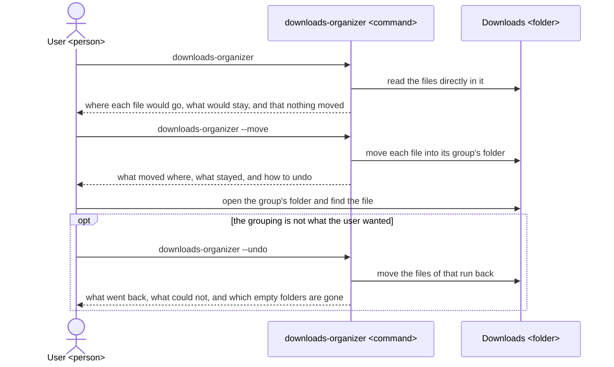
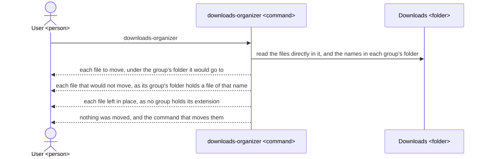
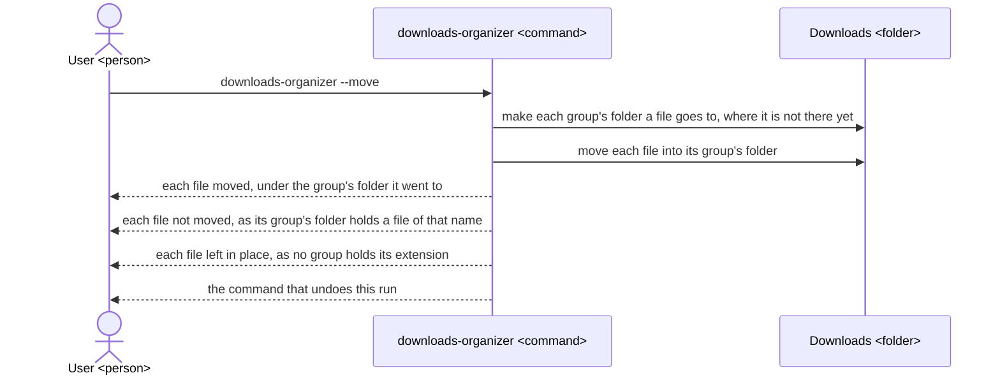
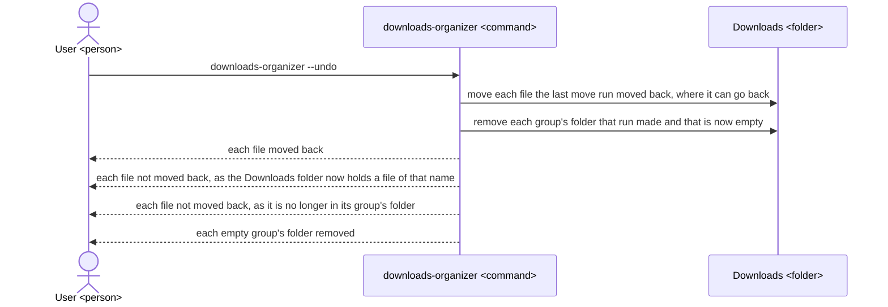
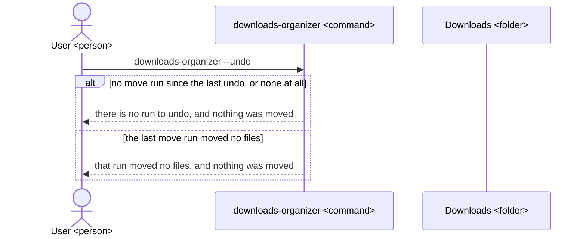

# Downloads organizer UX

The Downloads organizer gives a person whose Downloads folder holds too many files to find the one they want a way to group those files into one folder per type, see each move before it is made, and undo it, with no file lost; the tool, its README and its architecture are all built to this UX.

## Users and goals

- G1: A person on macOS or Linux whose Downloads folder holds so many files that they cannot find the one they are looking for finds it in the folder of its type, with every file still there.

  They know how to open a terminal and run a command, and they have files they do not want to lose, so they will not let a tool move anything before they have seen what it would do.

## Key results

They stand from the highest priority: a lost or changed file is a loss the user cannot get back, so it comes first; a file the user is not told about is one they go on looking for in the wrong place; a move the user did not see beforehand breaks the trust that lets them run the tool at all; only then does it count how many files end up grouped, and how many an undo brings back.

- KR1.1: The number of files, among those in the Downloads folder or in any folder under it before a run, that after the run are gone, renamed or changed in contents, or moved where the run did not say; fewer is better, and none once G1 is reached.

  Each file is counted once per run, for show, move and undo runs alike; a file the user moved or deleted themselves between runs is not counted. A user who loses even one file stops using the tool, so no other gain makes up for it.

- KR1.2: The number of files directly in the Downloads folder that a run leaves where they are, or that an undo leaves in a group's folder, without naming them in what it prints; fewer is better, and none once G1 is reached.

  Each file a run does not move, for any cause, is counted unless the run's output names it under that cause. A file left unnamed is one the user cannot tell is still there, so they look for it in its type's folder and do not find it.

- KR1.3: The number of files a move run puts in a different place from the one the show run just before it, on the same unchanged folder, said; fewer is better, and none once G1 is reached.

  Each file is counted once if it goes to another group's folder, is moved when the show run said it would stay, or stays when the show run said it would move. The user lets the tool move files because they saw what it would do, so each move they did not see is one they did not agree to.

- KR1.4: The share of files directly in the Downloads folder, among those whose extension a group holds, that after a move run are in their group's folder; more is better, and all of them, but for those the run names as not moved because a file of the same name was already there, once G1 is reached.

  The user finds a file by opening its type's folder, so each file of a known type not there is one they still have to dig for among the rest.

- KR1.5: The share of the files the undone move run moved that, after an undo, are back directly in the Downloads folder; more is better, and all of them, but for those the undo names as not moved back, once G1 is reached.

  The user undoes a run when the grouping is not what they wanted, so each file not back is one they have to find and move by hand.

## Scenes

The user types commands in a terminal, and the tool prints back what it did or would do. The figures name these: the user is `User <person>`; the tool is `downloads-organizer <command>`; the Downloads folder is `Downloads <folder>`, the one the tool works on; a group's folder is the folder inside the Downloads folder named after the group: `Images`, `Documents`, `Archives`, `Audio`, `Video` or `Installers`.

### The whole way



- The tool moves only files directly in the Downloads folder; it never moves, renames or deletes a folder there, or anything in a folder under it, but for the empty group's folders an undo removes.

  The user's own folders and what they put in each group's folder stay as they left them.

- The tool never deletes, renames or overwrites a file; a file it cannot move without doing so stays where it is and is named in what the run prints.

  This is what lets the user run it on files they cannot get back.

- A file's group is set by its extension, the part of its name after the last dot, whatever its case, so `photo.JPG` goes to `Images` as `photo.jpg` does, and `backup.tar.gz` goes to `Archives` by `gz`.

  A name with no dot, or whose only dot is its first character, such as `notes` or `.DS_Store`, has no extension and is left in place, as is a file whose extension no group holds, such as an unfinished download's `.crdownload` or `.part`.

- Each group holds these extensions, and no other.

  | Group | Extensions |
  | --- | --- |
  | Images | jpg, jpeg, png, gif, webp, heic, heif, bmp, tif, tiff, svg, ico |
  | Documents | pdf, doc, docx, odt, rtf, txt, md, xls, xlsx, ods, csv, ppt, pptx, odp, pages, numbers, key, epub |
  | Archives | zip, tar, gz, tgz, bz2, xz, 7z, rar, zst |
  | Audio | mp3, wav, flac, aac, m4a, ogg, opus, aiff, wma |
  | Video | mp4, mov, mkv, avi, webm, m4v, wmv, mpg, mpeg |
  | Installers | dmg, pkg, deb, rpm, appimage, exe, msi, apk |

- Two names are the same when the user's system treats them as the same, so on macOS `Report.pdf` is not moved into a `Documents` folder that holds `report.pdf`.

  macOS, unlike Linux, takes these as one file, and moving one onto the other would overwrite it.

- The tool works on the folder named after the command, as in `downloads-organizer ~/Desktop --move`, and on `~/Downloads` when none is named.

  A user whose downloads go elsewhere can use it.

### Seeing what would move



- A run with no instruction only shows: it moves, makes and removes nothing, so the user can run it as often as they like.

  For a folder holding `photo.jpg`, `report.pdf`, `setup.dmg`, `notes`, `data.xyz`, and a `Documents` folder that already holds a `report.pdf`, it prints:

  ```
  $ downloads-organizer
  In /Users/ana/Downloads, a run with --move would move 2 files:

  Images/
    photo.jpg
  Installers/
    setup.dmg

  Would not move 1 file, as its group's folder already holds a file of that name:
    report.pdf (Documents/report.pdf)

  Left in place 2 files, as no group holds their extension:
    notes
    data.xyz

  Nothing was moved. To move these files, run: downloads-organizer --move
  ```

### Moving the files



- A move run moves the files the show run just before it named, and the same files stay.

  On the folder of the show scene, it prints:

  ```
  $ downloads-organizer --move
  In /Users/ana/Downloads, moved 2 files:

  Images/
    photo.jpg
  Installers/
    setup.dmg

  Did not move 1 file, as its group's folder already holds a file of that name:
    report.pdf (Documents/report.pdf)

  Left in place 2 files, as no group holds their extension:
    notes
    data.xyz

  To move these files back, run: downloads-organizer --undo
  ```

- A move run that finds no file to move says so and moves nothing.

  ```
  $ downloads-organizer --move
  In /Users/ana/Downloads, moved no files.

  Left in place 2 files, as no group holds their extension:
    notes
    data.xyz
  ```

### Undoing the last move



- An undo undoes only the last move run on the Downloads folder it is given, so it never moves files in another folder; once it has, that run cannot be undone again, and no run before it is undone.

  After the move scene, the user has made a new `setup.dmg` directly in the Downloads folder and has moved `Images/photo.jpg` elsewhere; the undo prints:

  ```
  $ downloads-organizer --undo
  In /Users/ana/Downloads, moved back 0 of the 2 files the last run with --move moved.

  Did not move back 1 file, as the Downloads folder now holds a file of that name:
    Installers/setup.dmg

  Did not move back 1 file, as it is no longer in its group's folder:
    Images/photo.jpg

  Removed 1 empty folder that run made:
    Images/
  ```

  With nothing in the way, the same undo puts both files back and removes both folders, as that run made both:

  ```
  $ downloads-organizer --undo
  In /Users/ana/Downloads, moved back 2 of the 2 files the last run with --move moved:
    photo.jpg
    setup.dmg

  Removed 2 empty folders that run made:
    Images/
    Installers/
  ```

- A group's folder that was there before the undone run, or that holds anything once the files are back, stays as it is, and is not named.

### Nothing to undo



- When no move run has been made on that Downloads folder, or none since the last undo, the undo leaves the folder as it is.

  ```
  $ downloads-organizer --undo
  In /Users/ana/Downloads, there is no run with --move to undo. Nothing was moved.
  ```

- When the last move run moved no files, the undo leaves the folder as it is too, and does not reach back to an earlier run.

  ```
  $ downloads-organizer --undo
  In /Users/ana/Downloads, the last run with --move moved no files. Nothing was moved.
  ```

## Benefits

- The user finds a file by opening the folder of its type, as the tool puts every file of a known type there, instead of looking through every file they ever downloaded.

  They need not know its name or when it came; knowing it is a picture or an installer is enough.

- The user can run the tool on files they cannot get back without fear, as it shows each move before it makes any, never deletes, renames or overwrites a file, and names every file it leaves.

  Without that, they would sort the files by hand, the work they had put off.

- The user can take back a grouping they do not like with one command, as the tool moves the files of its last run back and removes the folders it made for them.

  Trying it costs them nothing they cannot undo.
