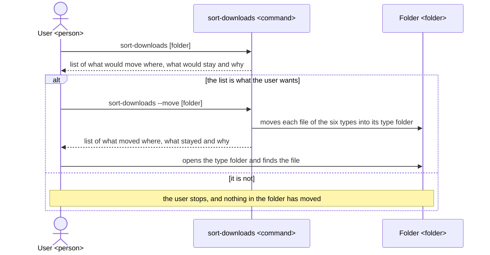
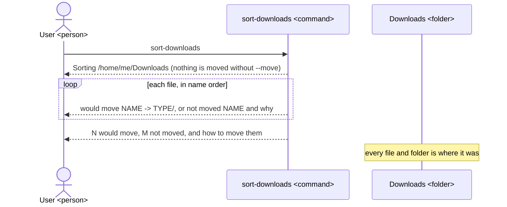
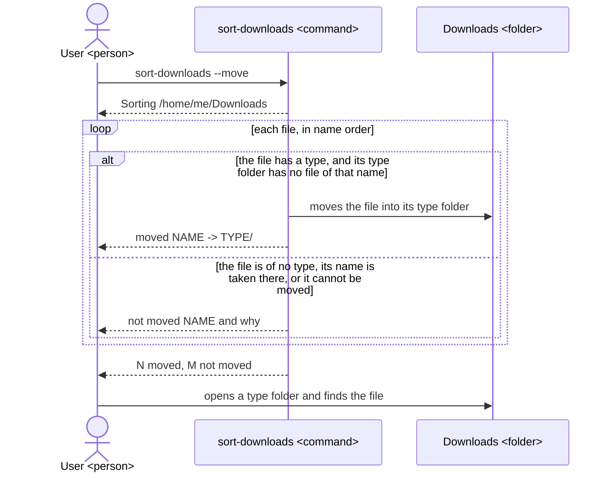
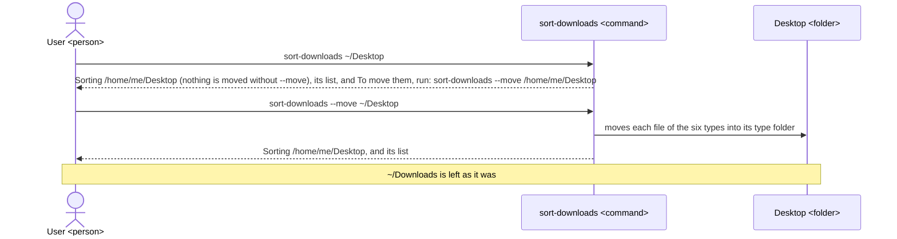
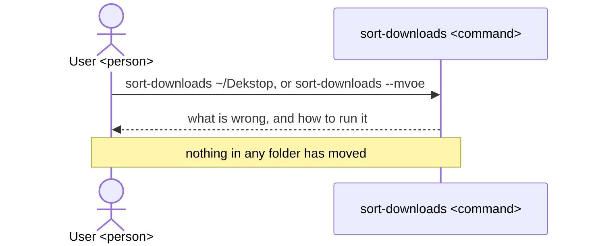

# sort-downloads UX

sort-downloads gives a person on macOS or Linux, whose Downloads folder has piled up, one command
that sorts the files there into one folder per type inside that same folder, first showing what it
would do and never deleting, renaming or overwriting a file; the tool, its README and its
architecture are all built to this UX.

## Users and goals

- G1: A person on macOS or Linux who downloads many files wants to find a file they downloaded by
  opening the folder of its type, without risk of losing any file.

  They use a terminal enough to type a command, and keep their downloads in `~/Downloads` or in
  another folder they name, such as `~/Desktop`.

## Key results

They stand from the highest priority: a lost or changed file cannot be undone, while a file left
unsorted can still be found by hand, and a list that tells true matters only once files are safe
and sorted.

- KR1.1: Files kept whole: the number of files that, after any run, are gone, renamed or changed in
  content, fewer being better; once G1 is reached it is none.

  Each file in the folder before the run is one case, judged by looking for a file of the same name
  and the same content in the folder or in one of its type folders after it. A file lost to sorting
  takes the user further from what they want than an unsorted pile does.

- KR1.2: Files found by type: of the files of the six types in the folder before a run told to
  move, the share that are in their type folder after it, higher being better; once G1 is reached
  it is every one whose name was free in its type folder.

  Each such file is one case, judged by whether it is in the type folder its extension names. Each
  file found there is one the user finds by opening that folder.

- KR1.3: Lists told true: of the files a plain run lists, the share for which a run told to move
  right after it does what the line said, and each file left in place has a line saying why,
  higher being better; once G1 is reached it is every one.

  Each listed file is one case, judged by comparing its line in the plain run with its line in the
  run told to move and with where it then is. The user decides to move from the plain run's list,
  so each line that does not tell true is a move they did not agree to.

## Scenes

Three take part: the user, `User <person>`, who types in a terminal; the tool,
`sort-downloads <command>`; and the folder being sorted, `<folder>`, which is `~/Downloads` when no
folder is written after the command, or the folder written there, and is shown by its name, such
as `Downloads`, or as `Folder` where it may be either. The words the figures and text use:

- A plain run is `sort-downloads` without `--move`, which only prints the list and moves nothing.
- A run told to move is `sort-downloads --move`, which moves the files and prints the list of what
  it did.
- A type folder is one of the six folders `Images`, `Documents`, `Archives`, `Audio`, `Video` and
  `Installers` inside the folder being sorted, made by a run told to move the first time a file
  goes into it.
- A file of no type is a file whose name has no extension, or has one that none of the six types
  holds.

### The whole way



### Plain run on Downloads



- The tool prints one line for each file, in the form below, for a Downloads folder holding
  `holiday.jpg`, `report.pdf`, `photos.zip`, `song.mp3`, `clip.mp4`, `setup.dmg`, `notes`,
  `data.xyz`, a folder `old`, a hidden file `.DS_Store`, and `invoice.pdf` with
  `Documents/invoice.pdf` already there.

  ```
  $ sort-downloads
  Sorting /home/me/Downloads (nothing is moved without --move)
  would move  clip.mp4     -> Video/
  not moved   data.xyz     no type
  would move  holiday.jpg  -> Images/
  not moved   invoice.pdf  Documents/invoice.pdf already exists
  not moved   notes        no type
  would move  photos.zip   -> Archives/
  would move  report.pdf   -> Documents/
  would move  setup.dmg    -> Installers/
  would move  song.mp3     -> Audio/
  6 would move, 3 not moved. To move them, run: sort-downloads --move
  ```

- Folders, the type folders among them, and hidden files, whose names start with `.`, get no line
  and are never moved.

  They are never sorted, and a line for each would bury the files the user is looking at.

- A file's type is told by the last part of its name after a `.`, upper or lower case alike.

  Images: jpg, jpeg, png, gif, heic, webp, bmp, tif, tiff, svg. Documents: pdf, doc, docx, xls,
  xlsx, ppt, pptx, odt, ods, odp, rtf, txt, md, csv, pages, numbers, key. Archives: zip, tar, gz,
  tgz, bz2, xz, 7z, rar. Audio: mp3, m4a, aac, wav, flac, ogg, aiff. Video: mp4, m4v, mov, mkv,
  avi, webm. Installers: dmg, pkg, deb, rpm, appimage. So `backup.tar.gz` is an archive.

- The last line gives the counts, followed, only when a file would move, by
  `To move them, run: sort-downloads --move`, with the folder in full after it when one was written,
  such as `sort-downloads --move /home/me/Desktop`.

  A folder whose files are all of no type or left in place gets their `not moved` lines and the
  last line `0 would move, 2 not moved` with no hint; only a folder with no file to give a line gets
  the one line `Nothing to sort in /home/me/Downloads`, in both runs.

### Run told to move



- On the same Downloads folder, the tool prints the lines of the plain run with `moved` for
  `would move`, and leaves `data.xyz`, `invoice.pdf`, `notes`, the folder `old` and `.DS_Store`
  where they were.

  ```
  $ sort-downloads --move
  Sorting /home/me/Downloads
  moved       clip.mp4     -> Video/
  not moved   data.xyz     no type
  moved       holiday.jpg  -> Images/
  not moved   invoice.pdf  Documents/invoice.pdf already exists
  not moved   notes        no type
  moved       photos.zip   -> Archives/
  moved       report.pdf   -> Documents/
  moved       setup.dmg    -> Installers/
  moved       song.mp3     -> Audio/
  6 moved, 3 not moved
  ```

- A moved file keeps its name and content, and the tool asks nothing before moving, as `--move` is
  the user's yes.

- A file the tool cannot move gets the line `not moved NAME cannot move: REASON` and stays where it
  was, while the other files are still sorted.

  Where its type folder's name is taken by a file, both runs give the line, as
  `cannot move: Images is not a folder`; where the system refuses the move itself, such as
  `cannot move: permission denied`, only the run told to move can know it, so the plain run gives
  that file `would move`.

- Run again on a folder sorted before, the tool moves only the files that came in since, and lists
  the files it left in place before again, each with its reason.

### Run on a folder the user gives



- The first line of every run names the folder it sorts in full, so the user sees which folder it
  is before reading the list.

  The full name is the system's own, such as `/Users/me/Downloads` on macOS and
  `/home/me/Downloads` on Linux, the form the scenes show.

- The type folders are made inside the folder given, such as `~/Desktop/Images`, and the lines and
  their forms are those of a run on `~/Downloads`, but for the folder named in them.

### When the tool cannot run



- For a folder that is not there or is not a folder, the tool prints
  `sort-downloads: /home/me/Dekstop is not a folder`, for an option it does not know
  `sort-downloads: unknown option --mvoe`, and for more than one folder
  `sort-downloads: give one folder only`.

  Each such message is followed by the line `Usage: sort-downloads [--move] [folder]`; when no
  folder is written and `~/Downloads` is not there, the message names `/home/me/Downloads`.

## Benefits

- The user finds a downloaded file by opening the folder of its type rather than scanning one long
  pile, because the tool puts every file of the six types into one fixed folder for its type.

- The user sorts without fear of losing a file, because the tool never deletes, renames or
  overwrites one, and its plain run shows each move before any is made.

- The user can sort any other folder that piles up, such as the Desktop, the same way, because the
  tool sorts whichever folder is written after the command.
