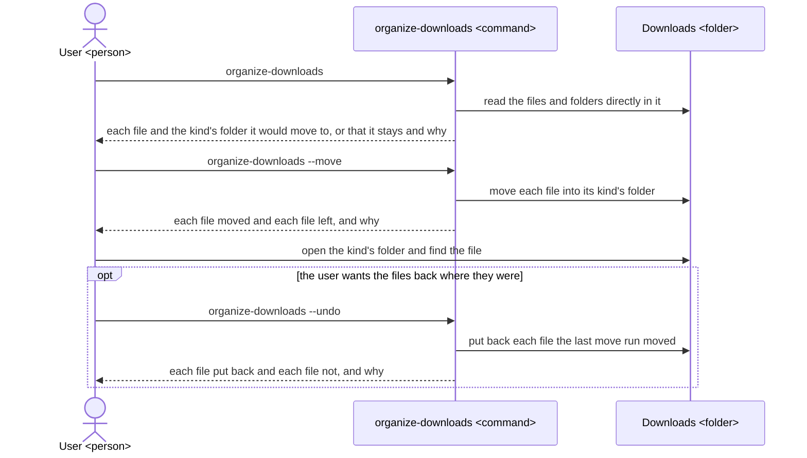
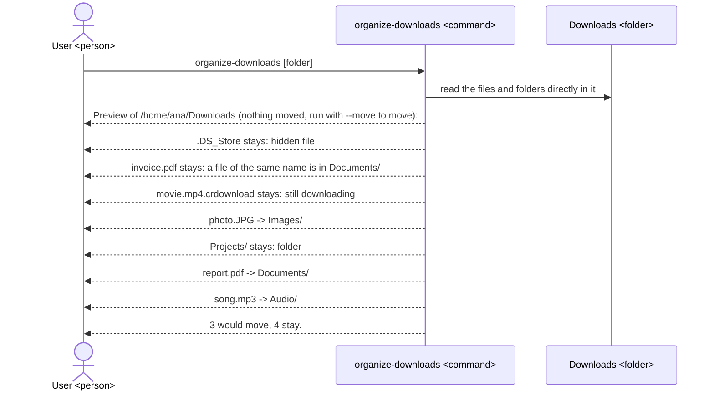
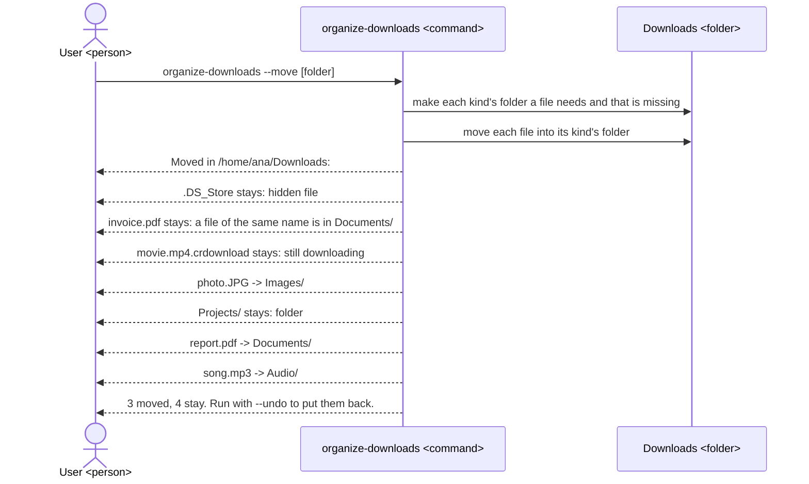
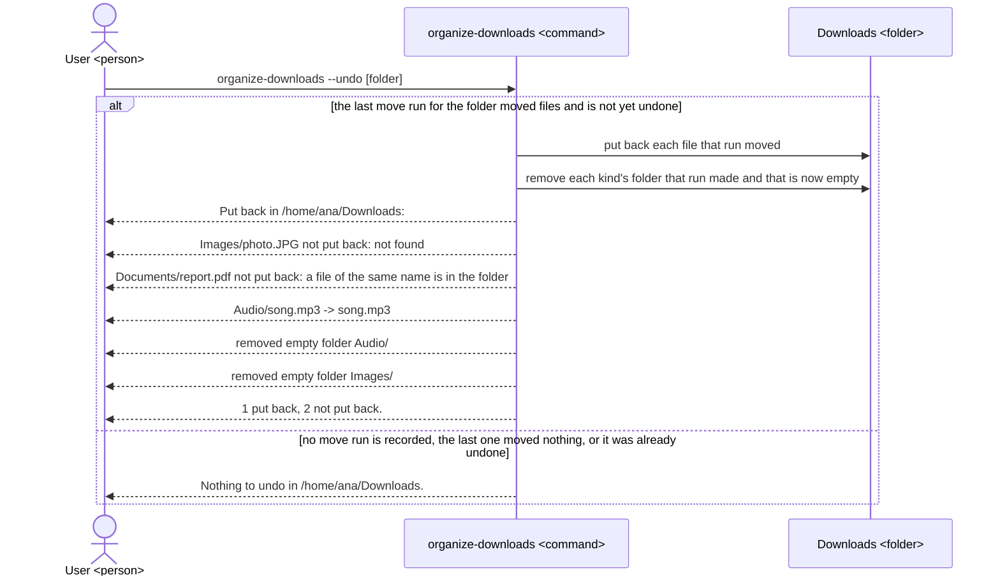

# organize-downloads UX

organize-downloads gives each person whose Downloads folder has grown too full to search a quick way to find a downloaded file again: it sorts the files there into one folder per kind of file, shows each move before it makes it, and can put back what it moved, without ever losing or changing a file; its README, its architecture and the tool itself are all built to this UX.

## Users and goals

- G1: A person on macOS or Linux who downloads files with a browser and can type a command in a terminal wants to find the file they want in their Downloads folder quickly, keeping every file they downloaded as it was.

  They are a user if they keep downloads in a folder on their own computer and would rather look in one folder of the right kind than scroll through everything they ever downloaded.

## Key results

They stand from the highest priority: a file lost or changed costs the user more than any sorting gains, a move the user cannot see beforehand or take back is one they will not dare to run, and only then does the place each file lands in decide how quickly they find it.

- KR1.1: The number of files, at any depth in the folder, that after a preview, a move or an undo are no longer there with the same name and contents, either where they were or in their kind's folder; fewer is better, and none once G1 is reached.

  Each such file is a download the user has lost, which no faster finding makes up for.

- KR1.2: The share of files directly in the folder that a move run moves to the kind's folder the preview just before it showed, or leaves for the reason it showed; higher is better, and all once G1 is reached.

  The user decides to move from what the preview shows, so each file handled otherwise is a move they did not agree to.

- KR1.3: The share of the files the last move run moved that an undo puts back directly in the folder, or names with the reason it did not; higher is better, and all once G1 is reached.

  Each file neither put back nor named is one the user has to hunt for after asking for everything back.

- KR1.4: The share of files a move run moves that land in the folder the user would look in for them, judged for each file by whether a person would call it of that kind, such as a photo in `Images` and a PDF manual in `Documents`; higher is better, and all once G1 is reached.

  The user finds a file quickly only by looking in the folder of its kind, so each file in another folder is one they look for in the wrong place.

## Scenes

The figures show the user, a person; `organize-downloads`, the command they type; and the folder, `~/Downloads` or the folder they name. A move run is a run with `--move`. A kind's folder is one of the folders below, directly inside the folder, and a file is told by its extension, the text after its last dot, whatever its letter case, so `photo.JPG` and `photo.jpg` both go to `Images`, and `backup.tar.gz` goes to `Archives`:

- Images: jpg, jpeg, png, gif, webp, heic, heif, bmp, tif, tiff, svg, ico
- Documents: pdf, doc, docx, xls, xlsx, ppt, pptx, odt, ods, odp, rtf, txt, md, csv, epub, pages, numbers, key
- Videos: mp4, mov, mkv, avi, webm, m4v, wmv, flv
- Audio: mp3, wav, flac, aac, m4a, ogg, opus, aiff, wma
- Archives: zip, tar, gz, tgz, bz2, xz, 7z, rar, zst
- Installers: dmg, pkg, deb, rpm, appimage, exe, msi, apk, snap, flatpak
- Code: py, js, ts, sh, json, yaml, yml, toml, xml, html, css, c, cpp, h, java, go, rs, rb, php, sql, ipynb
- Others: every file whose extension is in none of the kinds above, and every file with no extension

### The whole way

### Preview

- The preview changes nothing in the folder, so the user can run it as often as they like.
- Hidden files, names starting with a dot, stay as `stays: hidden file`; files ending in `.crdownload`, `.part` or `.download`, which a browser is still downloading, stay as `stays: still downloading`; each subfolder stays, with all it holds, as `stays: folder`, apart from the kinds' folders, which get no line and are not counted, as they are where files go rather than folders the user left there.
- A file named like a kind's folder, such as a file `Images` with no extension, keeps the files of that kind from moving, each shown as `stays: <kind> is a file, not a folder`, such as `stays: Images is a file, not a folder`.
- The lines for files and folders stand in the alphabetical order of their names, letter case aside, so the user finds a file's line where they expect it; in an undo, the lines for files stand in the order of the file names, then the lines for removed folders in the order of their names.

### Move

- The lines a move run shows are the lines the preview shows for the same folder, so the user sees that what they agreed to is what was done.

### Undo

After the move above, the user has saved a new `report.pdf` directly in the folder and deleted `Images/photo.JPG`.

- Undo goes back only to the last move run for the folder, and once undone that run is not undone again.
- A kind's folder that was there before the move run, or that still holds anything, such as `Documents` holding `report.pdf` above, is kept.

### Rules that hold in every scene

- With no folder named, the tool works on `~/Downloads`; with a folder named, such as `organize-downloads --move ~/Desktop`, it works on that folder alone.
- The tool only ever moves files directly in the folder into their kinds' folders and back, and deletes, renames or overwrites no file.
- A move run adds nothing to the folder but the kinds' folders: what undo needs to know is kept outside it, under `~/.local/state` on Linux and `~/Library/Application Support` on macOS.
- Given a folder that does not exist, the tool shows `organize-downloads: no folder at <path>` and changes nothing; given both `--move` and `--undo`, it shows `organize-downloads: use --move or --undo, not both` and changes nothing; with `--help` it shows `usage: organize-downloads [--move | --undo] [folder]` and what each option does.

## Benefits

- The user finds a download by opening the one folder of its kind, because the tool puts each file in the folder named for what it is.
- The user tidies the folder without fear of losing anything, because the tool only moves files, shows each move before making it, and puts back what its last move run moved.
- The user keeps the folder as it was apart from the kinds' folders, because hidden files, unfinished downloads and their own subfolders stay where they are and nothing else is added there.
