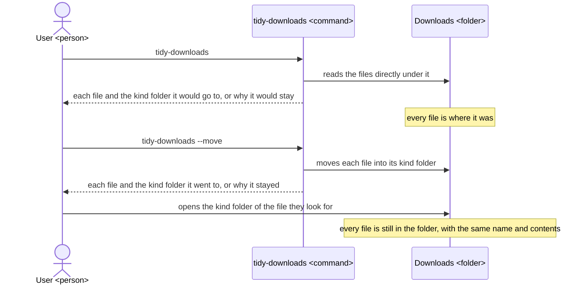
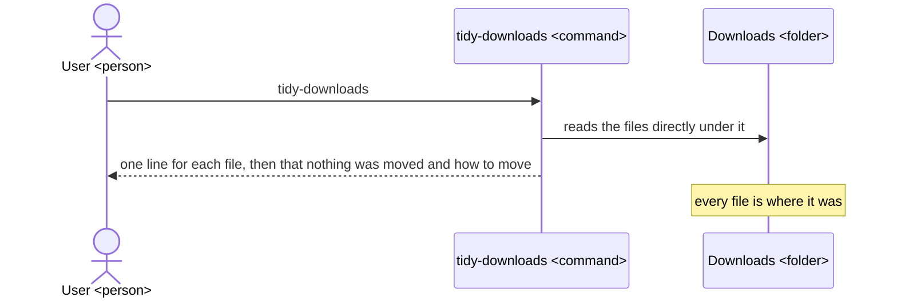
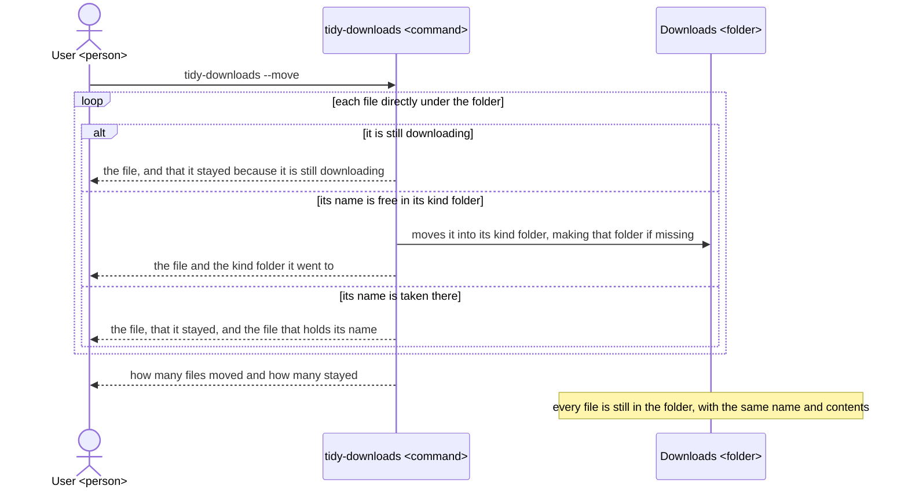
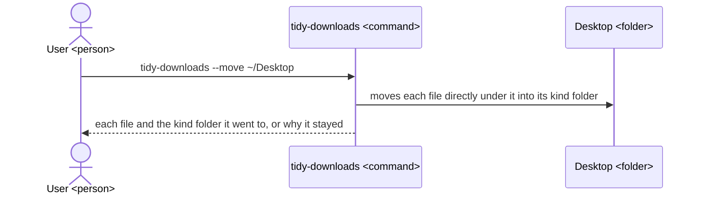
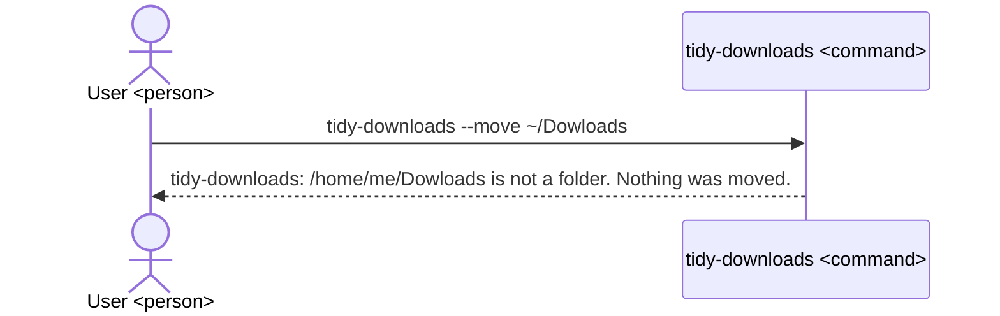

# tidy-downloads UX

tidy-downloads gives someone whose Downloads folder is crowded with files a way to sort those files into one folder for each kind, such as images or documents, without losing any of them; the tool, its README and its architecture are all built to this UX.

## Users and goals

- G1: Someone on macOS or Linux who saves downloads to their Downloads folder and can run a command in a terminal wants to find the file they look for among their downloads quickly, with no file lost.

  Today the files lie side by side directly under Downloads, so the one they look for is lost among the rest.

  The tool tidies `~/Downloads`, or another folder the user names after the command, by moving each file directly under it into a kind folder, a folder inside it named for the file's kind, such as `Images`; run alone, it only shows what it would move, and it moves files only when run with `--move`. A file directly under the folder is one in the folder itself, not inside any of its subfolders, and not one whose name starts with a dot, such as `.DS_Store` or `.localized`: the tool neither moves nor shows those, so files the user never sees stay as they are.

## Key results

They stand from the highest priority, because a tidy folder is worth nothing to the user if tidying it lost a file: KR1.2 is never brought closer by letting KR1.1 move away.

- KR1.1: The number of files lost, overwritten or changed in content by one run of the tool; fewer is better, and none once G1 is reached.

  A file counts if it was in the folder before the run and afterwards is nowhere in it, or is there with other contents, or had its contents replaced by another file's; each such file counts once. Every such file is one the user can no longer find, which is the opposite of G1.

- KR1.2: The number of files left directly under the folder after one run with `--move`; fewer is better, and once G1 is reached the only files left are those a browser is still downloading and those whose name is already taken in their kind folder.

  Each file left there counts once, and a kind folder is a folder, not a file, so it does not count. Each file left is one the user still has to look for among the rest, while each file moved sits in the one folder of its kind, where it is found among fewer files; the two kinds of file left once G1 is reached stay because moving them would break a download or overwrite a file, which KR1.1 ranks first.

## Scenes

The figures show three parties: the user (`User <person>`), the command they run (`tidy-downloads <command>`) and the folder it tidies (`Downloads <folder>`, or `Desktop <folder>` where the user names `~/Desktop`).

Each file's kind is set by its extension, the part of its name after the last dot, upper and lower case alike, and the file goes to the kind folder of that kind:

| Kind folder | Extensions |
|---|---|
| `Images` | jpg, jpeg, png, gif, webp, heic, svg, bmp, tiff |
| `Documents` | pdf, doc, docx, xls, xlsx, ppt, pptx, txt, md, csv, odt, ods, odp, rtf, pages, numbers, key |
| `Archives` | zip, tar, gz, tgz, bz2, xz, 7z, rar |
| `Installers` | dmg, pkg, deb, rpm, appimage, exe, msi |
| `Audio` | mp3, wav, m4a, flac, aac, ogg |
| `Video` | mp4, mov, mkv, avi, webm |
| `Code` | py, js, ts, json, html, css, sh, ipynb |
| `Other` | any other extension, or none |

So `photo.JPG` goes to `Images` and `backup.tar.gz` to `Archives`, by its last extension `gz`. A file ending in `.crdownload`, `.part` or `.download` is one a browser is still downloading, and it goes to no kind folder: it stays where it is, as the scene "Move the files" shows.

### The whole way



### See what would move



- Run alone, the tool never changes the folder, so the user can run it as often as they like before they move anything.

  What it prints, for example:

  ```text
  $ tidy-downloads
  Tidying /home/me/Downloads (nothing is moved without --move)
    report.pdf            -> Documents/
    photo.JPG             -> Images/
    setup.dmg             -> Installers/
    notes                 -> Other/
    invoice.pdf           stays: Documents/invoice.pdf already exists
    movie.mp4.crdownload  stays: still downloading
  Nothing was moved. Run tidy-downloads --move to move 4 files.
  ```

- With no file directly under the folder, the tool prints only `Nothing to tidy in /home/me/Downloads.`, with or without `--move`, so the user knows the folder is already tidy.

### Move the files



- The tool only moves files: it never deletes, renames or overwrites a file, and it leaves every subfolder and all inside it as they were, the kind folders included apart from the files it adds.

  So the worst a run can do is leave a file where it was, which the output names.

- A file still being downloaded stays where it was, so the download in progress is not broken; once it ends, the file has its real name, and the next run sorts it by its kind.

- A file stays where it was when its kind folder already holds a file of the same name, and the user sees which one, so they can rename either and run the tool again.

  What it prints for the folder of "See what would move", for example:

  ```text
  $ tidy-downloads --move
  Tidying /home/me/Downloads
    report.pdf            moved to Documents/
    photo.JPG             moved to Images/
    setup.dmg             moved to Installers/
    notes                 moved to Other/
    invoice.pdf           stays: Documents/invoice.pdf already exists
    movie.mp4.crdownload  stays: still downloading
  Moved 4 files. 2 files stayed where they were.
  ```

### Tidy another folder



- Every scene above holds for a folder named after the command just as for `~/Downloads`, with or without `--move`, so the user can try the tool first on a copy or a test folder.

### The folder cannot be tidied



- When the folder named, or `~/Downloads` when none is named, does not exist or is not a folder, the tool says so, moves nothing and ends with a failure status, so a typing slip never touches another folder.

## Benefits

- The user finds the file they look for by opening the one folder of its kind, because the tool puts each file directly under Downloads into the folder of its kind.

- The user tidies without fear of losing a file, because the tool shows first what it would do, never deletes or overwrites a file, and names each file it leaves where it was, and why.

- The user can tidy any folder, not only Downloads, on macOS and on Linux, because the tool takes the folder as an argument and needs nothing else.
