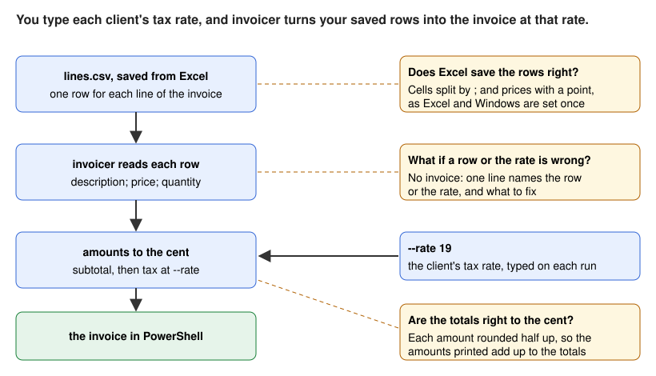

# `invoicer`

`invoicer` is a PowerShell command that prints an invoice from rows saved in Excel, at the tax rate you type.

`invoicer` is for you when you work in accounting, bill clients from invoice lines in Excel, and write no Python. With it, you print each client's invoice at their tax rate yourself, without asking a developer.

## Non-goals

- `invoicer` doesn't make a PDF: it shows the invoice as text, which you can copy into your letter.
- `invoicer` doesn't add the client's name, an invoice number or a date: it prints the lines and the totals.
- `invoicer` doesn't change the currency: it shows every amount in euros (EUR).
- `invoicer` doesn't take a tax rate for each line: one tax rate covers the whole invoice.

## Requirements

- A developer, signed in to Windows as the colleague, as pipx installs `invoicer` for one account: `whoami` shows the colleague.
- Python 3.9 or later, from [python.org](https://www.python.org/downloads/windows/): `py --version` shows it.

## Installation

```console
py -m pip install --user pipx
py -m pipx ensurepath
py -m pipx install https://github.com/lovaizu/playground/archive/refs/heads/main.zip
```

In a new PowerShell window, `invoicer --help` prints `usage: invoicer [-h] --rate PERCENT LINES`.

## Walkthrough

At the end, you have the client's invoice in PowerShell, with the tax at the rate you typed.

Do this once, so that Excel saves each price with a point, such as 12.50:

1. In Excel, choose **File** > **Options** > **Advanced**.
2. Clear **Use system separators**.
3. Set **Decimal separator** to `.` and **Thousands separator** to `,`, and choose **OK**.

Do this for each invoice:

1. Put each line of the invoice in a row: its description in column A, price in B, quantity in C.
2. Leave out a heading row, and write a discount as a negative price, such as -20.00.
3. Choose **File** > **Save a Copy**, or **Save As**, and choose the type **CSV UTF-8 (Comma delimited) (\*.csv)**.
4. Name the file `lines.csv`, and choose **Save**.
5. In File Explorer, open the folder that holds `lines.csv`, type `powershell` in the address bar, and press Enter. PowerShell opens in that folder.
6. In PowerShell, type `invoicer lines.csv --rate 19`, with the client's tax rate in place of 19, and press Enter.

These rows in Excel give the invoices below:

| A | B | C |
| --- | --- | --- |
| Design | 100.00 | 2 |
| Hosting | 10.50 | 1 |
| Discount | -20.00 | 1 |

For a client at 19%:

```console
PS> invoicer lines.csv --rate 19
Design                              200.00 EUR
Hosting                              10.50 EUR
Discount                            -20.00 EUR
Subtotal                            190.50 EUR
Tax                                  36.20 EUR
Total                               226.70 EUR
```

For a client at 7.7%, from the same rows:

```console
PS> invoicer lines.csv --rate 7.7
Design                              200.00 EUR
Hosting                              10.50 EUR
Discount                            -20.00 EUR
Subtotal                            190.50 EUR
Tax                                  14.67 EUR
Total                               205.17 EUR
```

## How it works

You type each client's tax rate, and `invoicer` turns your saved rows into the invoice at that rate.



### Are the totals right to the cent?

The subtotal adds up the amounts of the lines as printed, each rounded half up to the cent. `invoicer` rounds the tax to the cent too, so the printed amounts add up to the total.

### What if a row or the tax rate is wrong?

`invoicer` then prints no invoice, but one line that names the wrong row or tax rate and what to fix. Fix the row in Excel and save `lines.csv` again, or type the command with the right tax rate.

### Does Excel save the rows the way `invoicer` reads them?

Excel separates the cells with the list separator of Windows, which is `;` for euro formats such as German. If `invoicer` says that a row has 1 field, set **List separator** to `;` in **Control Panel** > **Region** > **Additional settings**.

## Documentation

- [Issues of lovaizu/playground](https://github.com/lovaizu/playground/issues): for the developers, to report a fault of `invoicer` or ask for a change.
