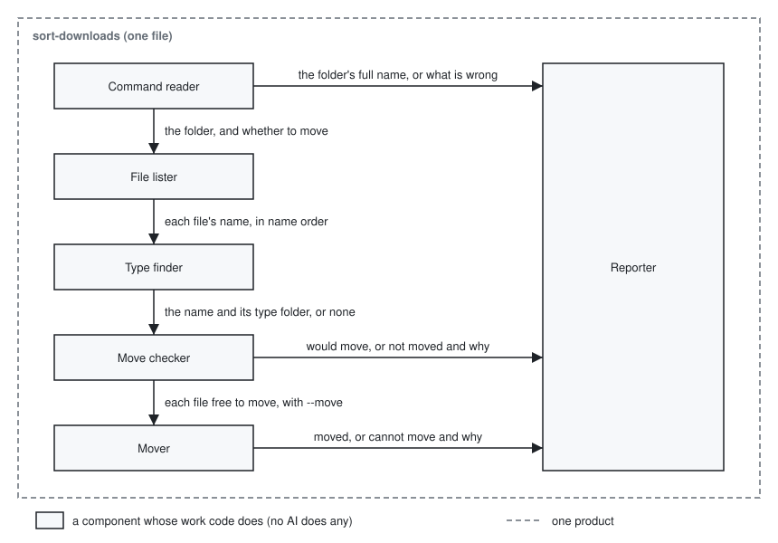

# sort-downloads architecture

sort-downloads is one POSIX shell script that takes the folder written after the command, or
`~/Downloads`, decides for each file in it the outcome the
[UX](../.rn/20261030-organize-downloads-cli/ux.md) gives, makes the move only in a run told to move,
and prints the list; its tests are a second POSIX shell script that GitHub Actions runs on macOS and
on Linux.

It is built on no other architecture, and rests on these principles of its own:

- No file is ever replaced, and no file is ever without a name: a file changes place only by a step
  the system refuses where the new name is taken, and loses its old name only once it has the new
  one.

  A lost or overwritten file cannot be undone, while a file left in place can still be found by
  hand (KR1.1 of the UX).

- The plain run and the run told to move decide each file by the same checks, and differ only in
  whether the move is made.

  The user decides to move from the plain run's list, which tells true only where it comes from the
  checks the move itself uses (KR1.3).

- The tool uses only what POSIX, the standard for Unix-like systems, defines for `sh` and its
  utilities, and nothing that changes with the user's language setting, so its one file runs alike
  on macOS and on Linux with nothing installed.

  macOS is certified to POSIX and Linux keeps a POSIX `/bin/sh` by the Filesystem Hierarchy
  Standard ([research](../.rn/20261030-organize-downloads-cli/research.md#1-language)), and the
  README gives one download URL for both.

- The tool changes nothing outside the folder it sorts and the type folders inside it.

  AC2 of the [acceptance criteria](../.rn/20261030-organize-downloads-cli/steering.md#acceptance-criteria)
  asks that nothing outside the folder be changed, and AC3 that `~/Downloads` be left as it was
  when another folder is given.

## User stories

- As a person whose downloads have piled up, I want to run `sort-downloads` and see where each file
  would move and why each other file stays, with nothing moved.

  The scenes "The whole way" and "Plain run on Downloads" rest on it.

- As that person, I want to run `sort-downloads --move` and have each file of the six types moved
  into its type folder, keeping its name and content.

  The scenes "The whole way" and "Run told to move" rest on it.

- As that person, I want to write a folder after the command and have that folder sorted in place
  of `~/Downloads`.

  The scene "Run on a folder the user gives" rests on it.

- As that person, I want a command I mistyped to tell me what is wrong and how to run it, and move
  nothing.

  The scene "When the tool cannot run" rests on it.

## Architecture

### Logical view



- The components act in the order of the arrows from the top: the Command reader settles the folder
  and whether to move, the File lister hands each file in turn to the Type finder and then to the
  Move checker, the Mover moves each file the Move checker finds free in a run told to move, and
  the Reporter prints once every file has its outcome.

  The Reporter waits for every outcome because the list's name column is as wide as the longest
  name in it, as the UX's lists show.

- The Command reader takes `~/Downloads` from `HOME` where no folder is written, and names the
  folder by its full name with no symbolic link in it (`pwd -P`); where the command is wrong, it
  hands the Reporter only what is wrong, and no other component runs.

  The tests point `HOME` at a temporary folder to check AC3 without the runner's own Downloads, and
  stopping before the File lister is what keeps a mistyped folder or option from moving anything.

- The script sets `LC_ALL=C` before any component acts, so every one of them works under the C
  locale, the language setting that compares names byte by byte, capitals before small letters.

  The user decided on one name order on every system, and a shell's `*` sorts names by the user's
  language setting
  ([research](../.rn/20261030-organize-downloads-cli/research.md#not-settled)); under the C locale
  the system's reasons the Mover hands on are in English too, as the UX's lines are.

- The File lister gives names in that byte order, and leaves out folders and names starting with
  `.`.

- The Move checker counts a name in the type folder as taken whatever stands under it, a file, a
  folder or a symbolic link even to nothing, and finds a type folder's name taken by a file, so the
  plain run lists both cases as the run told to move does.

  `ln`, which the Mover uses, puts a file inside a folder of the name rather than refusing, so only
  this check keeps such a file from landing one folder deeper.

- The Mover makes the type folder where it is not there yet, gives the file a second name inside it
  by a hard link (`ln -P`), which is one file under two names, and then removes the old name
  (`rm -f`); where the link is refused it hands the Reporter the system's reason, and where the
  removal fails it removes the new name.

  `mv` replaces a file of the same name, and `mv -n` leaves a gap between its check and its move on
  macOS and changes its exit status between coreutils versions on Linux, while the system refuses a
  hard link to a taken name in one step on both
  ([research](../.rn/20261030-organize-downloads-cli/research.md#2-moving-without-overwriting));
  `-P` moves a symbolic link itself rather than the file it points to, `-f` keeps `rm` from asking
  about a read-only file, and a run stopped between the two steps leaves one file under two names,
  which the next run lists as already there, never a lost one.

### Physical view

```
playground/
├── sort-downloads                <POSIX sh script>: the Command reader, the File lister, the Type
│                                   finder, the Move checker, the Mover and the Reporter, each a
│                                   shell function
├── tests/
│   └── sort-downloads-test.sh    <POSIX sh script>: the tests
├── .github/
│   └── workflows/
│       └── test.yml              <GitHub Actions workflow>: runs the tests on each runner
├── docs/
│   ├── architecture.md           <Markdown>: this document
│   └── architecture.svg          <SVG>: the logical view
├── README.md                     <Markdown>: install and use
└── LICENSE                       <plain text>: the MIT License
```

- The tool depends on `/bin/sh` and the utilities `ln`, `rm`, `mkdir` and `pwd` as POSIX defines
  them, and on the sorted folder's filesystem allowing hard links.

  Where a filesystem does not allow them, such as some USB drives, each file gets a `cannot move:`
  line and stays where it was, as nothing is replaced.

- The user starts the tool by typing `sort-downloads` in a terminal once it is installed as the
  [README](../README.md#installation) says; the file sits at the repository root because the
  README's download URL names it there.

- The tests are started by `sh tests/sort-downloads-test.sh` from the repository root, and by the
  workflow on every push and pull request.

## Test

The project has no rules of its own for how its parts are checked, so the lines below are those
rules.

- The user stories are checked by the test script running `sort-downloads` itself, as the user runs
  it, on the trial folder of AC1 made fresh inside a temporary folder that also holds the `HOME` it
  sets, under a language setting other than C.

  The six components are functions of one file with no edge of their own to the user, so the lines
  the tool prints and the files it leaves, compared by name and content before and after each run
  across the whole temporary folder, are what AC1, AC2 and AC3 judge, outside the folder sorted
  included.

- Every test runs on the GitHub-hosted runners `ubuntu-24.04`, `ubuntu-26.04` and `macos-latest`,
  under each runner's own `/bin/sh`, and the test script first prints which `ln` it runs on each.

  `ubuntu-24.04` holds GNU coreutils and `macos-latest` macOS's own `ln`, and `ubuntu-26.04` is in
  the list for the Rust coreutils Ubuntu ships since 25.10, though whether that runner's `ln` is the
  Rust one was not checked
  ([research](../.rn/20261030-organize-downloads-cli/research.md#3-where-the-tests-run)), so the
  printed `ln` is what shows the reader which ones the Mover was tried on; Ubuntu's `/bin/sh` is
  dash, which accepts little beyond POSIX, and the runners are free on this public repository.

- The Mover is checked beyond the stories in every way a move can be refused or a name be taken,
  a refusal by the system included, each run comparing every file before and after.

  A failure of the Mover loses or overwrites a file, which the user cannot undo, and how the Rust
  coreutils' `ln` refuses and what each `ln` says on a refusal were not read
  ([research](../.rn/20261030-organize-downloads-cli/research.md#not-settled)), so only a run on
  each runner shows them.

- The tool's script is also checked by `shellcheck --shell=sh` on `ubuntu-24.04`.

  A construct beyond POSIX can pass on one runner's `sh` and fail on a user's, and shellcheck, a
  checker of shell scripts already on that runner, names such constructs.

- The Command reader, the File lister, the Type finder, the Move checker and the Reporter are
  checked by the story tests alone, with no property tests or mutation testing.

  A failure in them gives a wrong line or leaves a file unsorted, which the user sees in the list
  and puts right by hand, never a lost file, as only the Mover moves and its link refuses a taken
  name whatever the Move checker found.

- The test script is checked by shellcheck as the tool's script is, and by seeing each test fail
  once on a copy of the tool broken on purpose before the test is kept; the workflow is checked by
  its runs on the three runners alone.

  A failure of either costs the user no file at once, but lets a fault of the tool reach them
  unseen, and a test that passes whatever the tool does is the failure a run of the tests cannot
  show.

- The README is checked by a person following its install and use steps on macOS and on Linux
  before each change to it is merged, and LICENSE and the documents in `docs/` are checked by being
  read alone.

  A wrong README step leaves the user without the tool or running it wrongly (AC5), which they meet
  at once and which moves no file without `--move`; LICENSE and `docs/` hold nothing the tool runs.
