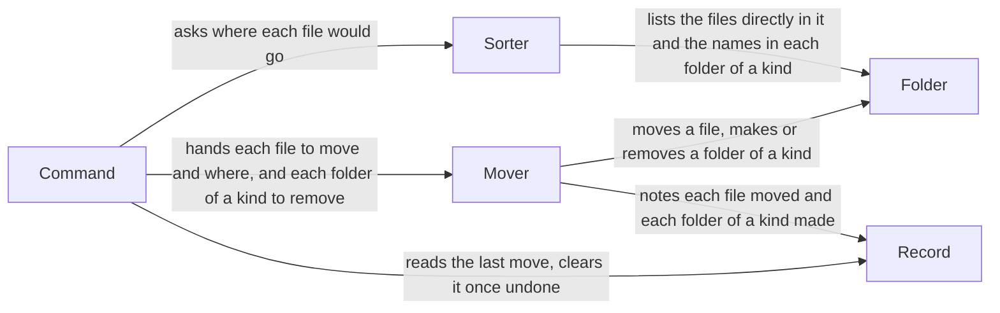

# tidy-downloads architecture

tidy-downloads is one Python 3 script, run as a command in a terminal, that sorts the files
directly in the folder it is run on into the folder of each one's kind, and keeps in that folder a
hidden record of its last move so that an undo can put the files back; it gives the UX defined in
[docs/ux.md](ux.md), where the user, the folder, a folder of a kind, a preview, a move, an undo and
the last move are each defined under [Scenes](ux.md#scenes); here too a move is always such a
run, and a single file going into another folder is said as moving a file.

It is built on nothing but Python 3, so the principles it rests on are its own:

- One component alone, the Mover below, moves a file or makes or removes a folder in the folder,
  and it puts a file only at a path where nothing is, checking this as it moves each file.

  Every file a move or an undo moves passes through it, so this one check keeps every file of the
  user's from being deleted, renamed or overwritten, even where a file has come into the folder
  since the Sorter looked.

- The tool keeps what it must remember only inside the folder it sorts.

  The record goes with the folder when it is moved or renamed, is never mixed with another
  folder's, and sits at the same place on macOS and Linux.

- The tool is whole in its one file, needing nothing installed beside it.

  Copying the file onto the PATH is then the whole installation, on macOS and Linux alike.

## User stories

- As the user, I want to see, before anything moves, the folder of a kind each file directly in
  the folder would go to, and each file that would stay where it is.
- As the user, I want to move each file directly in the folder into the folder of its kind, so that
  I find it there.
- As the user, I want to put the files of the last move back where they were.

## Architecture

### Logical view



- A preview runs the Sorter alone and prints its plan, so no preview can move a file.
- A move hands the Sorter's plan to the Mover, and the Command prints what the Mover reports for
  each file: moved, or left where it is and why.
- The Mover starts a new record with the first file a move moves, and notes each file as it moves
  it.

  A move that moves no file then leaves the last move's record as it was, and a move cut off midway
  leaves a record of each file it did move.

- The Sorter leaves the record's own file out of the files it plans to move.

  The record must stay where an undo looks for it.

- An undo hands the Mover each file the record holds, to go back where it was, and never asks the
  Sorter.

  Which files go back is what the last move did, not what their kinds say, so a file the user put
  in a folder of a kind themselves stays there.

- Once the Mover has dealt with those files, the Command has it remove each folder of a kind the
  record says the last move made, where it is empty, and then clears the record.

  An undo run a second time then finds no last move, and a folder that still holds a file stays.

### Physical view

```text
tidy-downloads repository
├── tidy-downloads               <Python 3 script: Command, Sorter, Mover>
└── tests/
    └── test_tidy_downloads.py   <Python 3 unittest tests>
the folder the tool is run on, such as ~/Downloads
└── .tidy-downloads-last         <JSON file: Record>
```

- The tool depends on Python 3 alone, its standard library included, on macOS or Linux; the
  script's first line finds `python3` on the PATH.
- It is started as the command `tidy-downloads` in a terminal, once copied onto the PATH as the
  README's [Installation](../README.md#installation) says.
- JSON suits the record, as Python reads and writes it with its standard library and a person can
  read it with `cat`.

## Test

The project has no test rules apart from this section: the script and the user stories are
checked by the tests in `tests/`, each a Given, a When and a Then, which run the script as the user
does, on a temporary folder made for the test that holds files of mixed kinds and subfolders, never
on the real Downloads folder.

- Each user story is checked by runs of the script, and each component through the runs of the
  stories it serves.

  The components are one file, run as a whole, so a run is where each one's part shows.

- A test that runs the script with no folder named points `HOME` at a temporary folder.

  The Downloads folder the script then sorts is the test's own, never the user's.

- The tests are run on macOS and on Linux.

  The tool must work on both, and a pass on one does not show the other.
