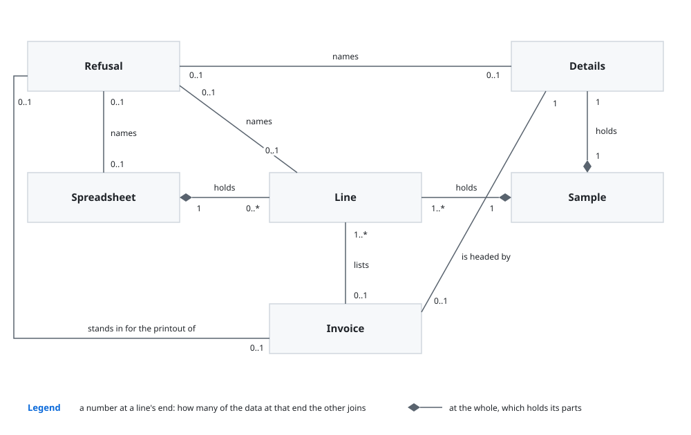
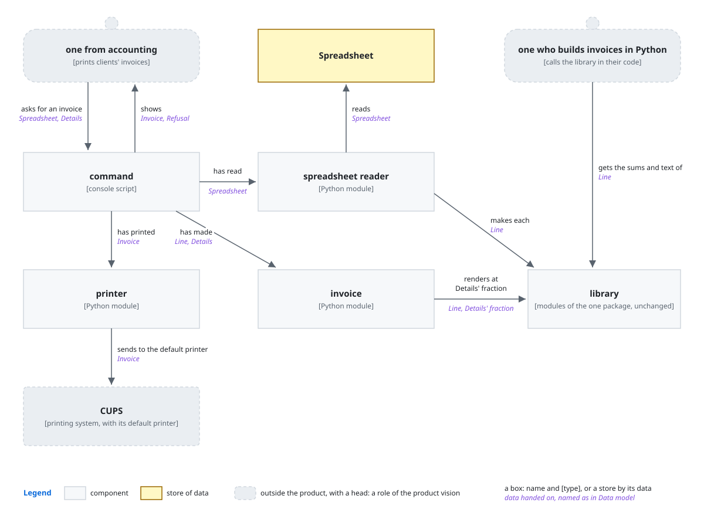
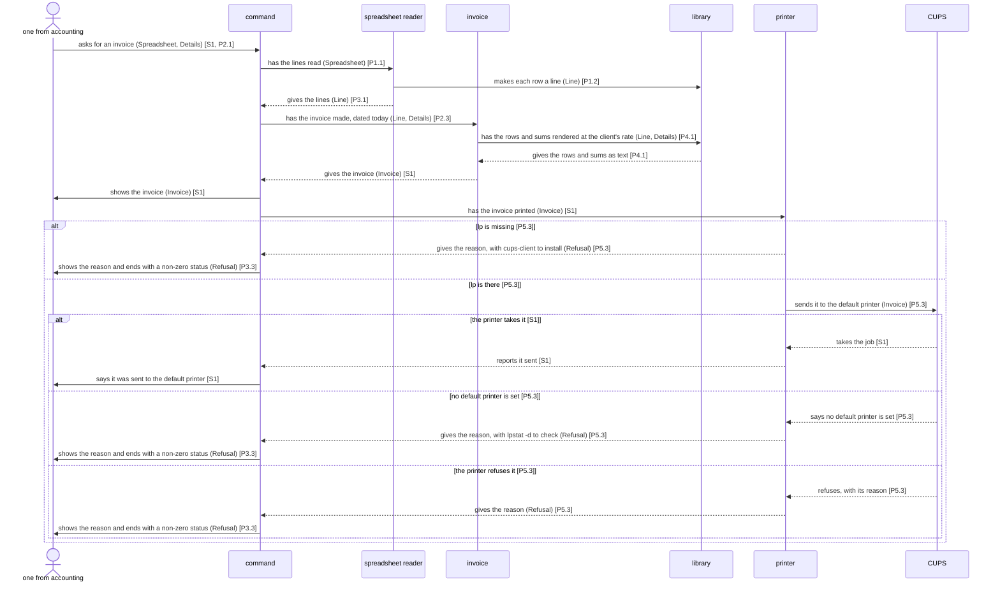
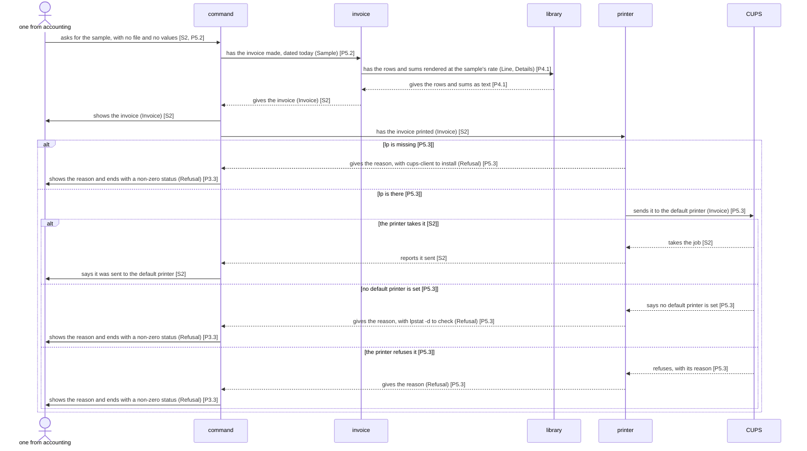
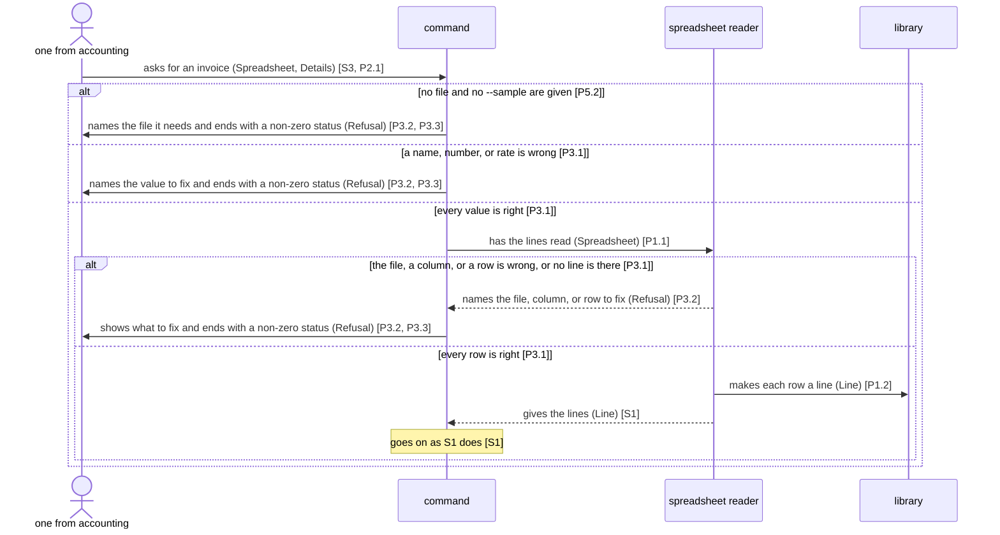
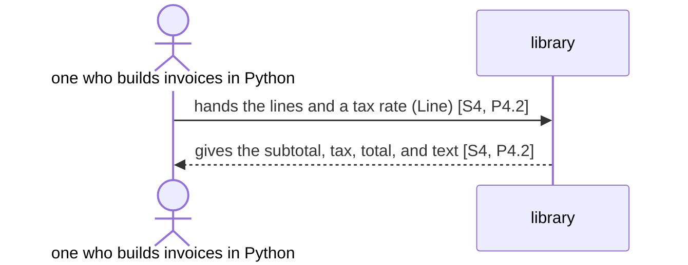
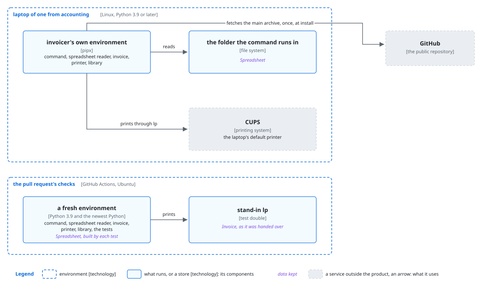

# `invoicer` architecture

## User stories

- `S1`: one from accounting wants to print a client's invoice unaided, at its tax rate, named, numbered, and dated today.
- `S2`: one from accounting wants a sample invoice printed after setting up, to know printing works before a client's invoice.
- `S3`: one from accounting wants to learn which line or value to fix when one is wrong, with nothing printed.
- `S4`: one who builds invoices in Python wants an invoice's sums and text from its lines and rate, as before.

## Solution strategy

### Principles

invoicer prints the invoice straight from the spreadsheet accounting keeps, given only the client's name, invoice number, and tax rate.

- `P1`: lines as kept
  - `P1.1`: invoicer reads the lines from the .ods file itself, so no one retypes or reshapes a line.
  - `P1.2`: the lines come from the first sheet, under Description, Price, and Quantity, and invoicer skips other columns.
- `P2`: everything per invoice
  - `P2.1`: every run for a client's invoice gives the client's name, the invoice number, and the tax rate in percent.
  - `P2.2`: invoicer keeps nothing of one invoice for the next, so no client's details reach another's invoice.
  - `P2.3`: each invoice bears the date of the day it prints.
- `P3`: a stop before printing
  - `P3.1`: invoicer checks every line and value before anything prints.
  - `P3.2`: a refusal names the row or value to fix, and nothing prints.
  - `P3.3`: every refusal exits non-zero, so the terminal and its tests tell a stop from a print.
- `P4`: the same sums
  - `P4.1`: only invoicer's library counts the subtotal, tax, and total of the given lines at the given rate.
  - `P4.2`: the library's calls and their results stay as they are for those who build invoices in Python.
- `P5`: ready in one step
  - `P5.1`: invoicer needs nothing beyond Python's standard library, so the one install command brings nothing beside it.
  - `P5.2`: a sample invoice, which needs no file or values, prints only when asked for.
  - `P5.3`: the invoice prints on the default printer, or invoicer gives the printer's reason and the Requirement to check.

### Data model



- Spreadsheet\
  Holds the lines of one invoice on its first sheet, as accounting keeps them.
- Line\
  Says what one item of the invoice is for, its price, and how many.
- Details\
  Hold the client's name, the invoice number, and the tax rate given for one invoice.
- Sample\
  Holds the lines and details of a fixed invoice, which shows that printing works.
- Invoice\
  Shows the details and today's date, then each line's amount, the subtotal, the tax, and the total.
- Refusal\
  Names what to fix before anything shows: the file, a column, a row, or a value. Once the invoice shows, it gives the printer's reason and the Requirement to check, in place of the printout.

Strategies:

- A refusal names only the first wrong value, column, or row that the checks meet. [P3.2]\
  Intent: one from accounting fixes one cell, then runs the command again.
- An invoice and its details live only for the run that prints it. [P2.2]\
  Intent: no client's details reach another client's invoice.

### Components



- command (console script)\
  Answers for each run giving one from accounting their printed invoice, the sample, or what to fix.
- spreadsheet reader (Python module)\
  Answers for the lines exactly as the spreadsheet keeps them, or the file, column, or row to fix.
- invoice (Python module)\
  Answers for an invoice that names its client, number, date, and rate, then gives the library's rows and sums.
- printer (Python module)\
  Answers for the invoice reaching the laptop's default printer, or for the reason it didn't and what to check.
- library (Python package, unchanged)\
  Answers for each line's amount, the subtotal, the tax to the cent, the total, and their text.

Strategies:

- The command checks the client's name, the invoice number, and the rate before it reads the file. [P3.1]\
  Intent: a wrong value stops the run before the spreadsheet is read.
- The command refuses an empty name or number, and a rate that isn't a number from 0 to 100. [P3.2]\
  Intent: every invoice is named, numbered, and taxed at a rate that can be right.
- Only `invoicer --sample` prints the sample, and a run with no file and no `--sample` refuses, naming the file it needs. [P5.2]\
  Intent: a command typed by mistake never prints the sample in place of a client's invoice.
- Only the command writes to the terminal and sets the exit status. [P3.3]\
  Intent: every refusal reaches one from accounting the same way.
- The command hands the invoice today's date, and the invoice takes the date it's given. [P2.3]\
  Intent: each invoice is dated the day it prints, and a test can fix the date.
- The command holds the sample's lines and details. [P5.2]\
  Intent: one from accounting sees invoicer print before they give it their own file.
- The spreadsheet reader reads the .ods file that LibreOffice Calc saves, and refuses any other form. [P1.1]\
  Intent: accounting's file reads as they keep it, with no export on the way.
- The spreadsheet reader finds the three columns by their names in row 1, wherever they stand. [P1.2]\
  Intent: a sheet kept with more columns, or in another order, reads as kept.
- The spreadsheet reader skips a row whose three cells are empty, and refuses a sheet with no line. [P3.1]\
  Intent: a blank row costs nothing, and an empty invoice never prints.
- The spreadsheet reader takes each price to the cent and each quantity as a whole number, refusing any other. [P4.1]\
  Intent: each line's amount comes out as the library counts it, to the cent.
- The spreadsheet reader names each row by its number as Calc shows it. [P3.2]\
  Intent: one from accounting finds the cell to fix at once.
- The spreadsheet reader reads the file with Python's standard library alone. [P5.1]\
  Intent: the install brings nothing beside invoicer.
- The invoice hands the library the lines and rate, and heads its unchanged rows and sums with the details. [P4.1]\
  Intent: the printed sums are the library's own, at the client's rate.
- The printer hands the invoice's text to CUPS's lp command, with no printer named. [P5.3]\
  Intent: the invoice comes out of the printer that one from accounting already uses.
- The printer tells lp missing, no default printer, and CUPS refusing apart, each with the Requirement to check. [P5.3]\
  Intent: one from accounting mends their laptop's printing alone, by the README.
- The new parts call the library only through its public calls, and change none of it. [P4.2]\
  Intent: code that builds invoices in Python keeps working as before.

### Sequences

#### S1: a client's invoice on paper



#### S2: the sample invoice after setting up



#### S3: what to fix, with nothing printed



#### S4: the sums and text in their own code



### Deployment



One from accounting starts invoicer by running its command in the spreadsheet's folder, once pipx has installed it.

Strategies:

- invoicer runs in its own environment that pipx makes from the repository's main archive on GitHub. [P5.1]\
  Intent: one install command sets invoicer up, apart from the laptop's own Python.
- invoicer runs on Python 3.9 or later, the floor that its package declares. [P5.1]\
  Intent: the Python that accounting's laptops already have is enough to install it.
- Nothing goes over the network after the install, which fetches the public repository's main archive from GitHub. [P5.1]\
  Intent: invoicer needs only the laptop and its printer once it's set up.
- The command reads the spreadsheet at the path it's given, from the folder it runs in. [P1.1]\
  Intent: one from accounting runs it where they keep the file.
- The pull request's checks run every test in a fresh environment, with a stand-in for lp. [S1]\
  Intent: each change is known to print the right invoice before it merges.

### Directory structure

```text
invoicer/            the package that pipx installs: the command, its parts, and the library
  __init__.py        the library's public calls
  lines.py           the library: Line and parse_lines
  tax.py             the library: tax_of
  totals.py          the library: subtotal and total
  render.py          the library: render
  cli.py             the command, with the sample
  ods.py             the spreadsheet reader
  invoice.py         the invoice, with the details given for it
  printer.py         the printer
  refusal.py         the refusal, which each new part gives and the command shows
tests/               the unit, integration, and end-to-end tests
  bin/lp             the stand-in lp, which records what it was given
docs/                the product vision and this architecture, for the developers
  images/            this architecture's figures
images/              the README's figures
pyproject.toml       the package, with invoicer as its console script, Python 3.9 or later, and no dependency
.github/workflows/   the pull request's checks
```

Strategies:

- The command and its parts live beside the library in one package, with no dependency. [P5.1]\
  Intent: one install brings everything invoicer needs.
- Each part, the library included, has its unit tests, which use only the standard library's unittest. [P5.1]\
  Intent: the tests need nothing installed beside Python.
- The integration tests build a real .ods file in each test, and put the stand-in lp first on the path. [S1]\
  Intent: the joined parts run as on the laptop, with no paper printed.
- The end-to-end test installs the package fresh, then runs the sample and one invoice with the stand-in lp. [S1, S2]\
  Intent: the install and both runs work as the README says.

## Test strategy

| Check | Test target | Kind | Exit criteria or measure |
|---|---|---|---|
| Lint | Parts | Quality | 0 findings. |
| Static analysis | Parts | Quality | 0 findings. |
| Complexity analysis | Parts | Quality | Each limit at its tool's default, such as a cognitive complexity of 15. |
| Unit testing | Parts | Quality | Every case passes. |
| Code coverage | Parts | Quality | 100% statement (C0) and branch (C1) coverage of each part, the library included. |
| Property-based testing | Parts | Quality | 0 counterexamples, such as an invoice whose sums differ from the library's for the same lines and rate. |
| Mutation testing | Parts | Quality | 0 surviving mutants. |
| Characterization testing | Parts | Quality | Every case passes: the library gives invoicer 1.4.0's sums and text for the same lines and rate. The library has no test yet. |
| Data compatibility testing | Parts | Quality | The spreadsheet reader reads, without loss, each kind of cell that LibreOffice Calc saves in a line. |
| Integration testing | Architecture | Quality | Every case passes. |
| Contract testing | Architecture | Quality | For each recorded step, the real printing system gives the same result as its stand-in. |
| Traceability | Architecture | Quality | Each story, principle item, component, and data has an integration test. Each test names an element or case one level up that exists. A review finds 0 tests that miss what their element says. |
| Scenario testing | Product | Quality | Every case passes. |
| Installation testing | Product | Quality | The README's install command installs invoicer on a fresh system, and the sample then prints. The README documents no update or uninstall, so none is checked. |
| Configuration testing | Product | Quality | Every case passes on Python 3.9 and on the newest Python. |
| Usability testing | Product | Benchmark | The share of invoices that one from accounting prints unaided and right. The time from the lines ready to the invoice printed, README included. |
