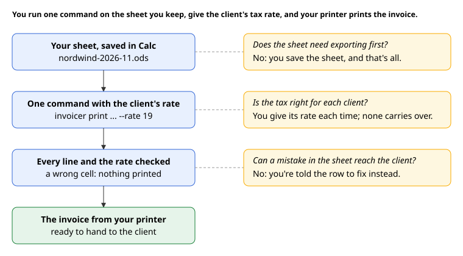

# `invoicer`

invoicer is a command-line tool that prints a client's invoice, with its totals and tax, from your Calc sheet.

invoicer is for you when you keep a client's invoice lines in LibreOffice Calc on a Linux laptop. With it, you hand each client an invoice at their own tax rate, without a developer's help.

## Non-goals

- invoicer doesn't apply different tax rates within one invoice: every line takes the rate you give.
- invoicer doesn't choose the invoice number: you type it in the sheet's `Invoice number` row.
- invoicer doesn't save the invoice as a PDF or send it by email: it prints it on paper.

## Requirements

- Python 3.9 or later: `python3 --version` shows it.
- pipx: `pipx --version` shows its version, and on Ubuntu `sudo apt install pipx` installs it where it's missing.
- git: `git --version` shows it, and on Ubuntu `sudo apt install git` installs it where it's missing.
- A default printer: `lpstat -d` shows it, and if none, set the office printer as default in Settings, then Printers.

## Installation

```console
pipx install git+https://github.com/lovaizu/playground
pipx ensurepath
```

Open a new terminal, and `invoicer --help` shows `usage: invoicer print SHEET --rate PERCENT`.

## Walkthrough

At the end, you have Nordwind's invoice for November on paper, at Nordwind's tax rate of 19%.

invoicer reads the first sheet of the file, laid out as accounting's invoices are from now on. Put each detail in its own row: its label in column A, as below, and its value in column B. Below the details, a header row names `Description`, `Price`, and `Quantity`, in any column order. Each row under that header is one line of the invoice, up to the first empty row.

This is `nordwind-2026-11.ods` as Calc shows it:

|    | A                   | B                           | C        |
|----|---------------------|-----------------------------|----------|
| 1  | `Invoice number`    | 2026-041                    |          |
| 2  | `Date`              | 2026-11-19                  |          |
| 3  | `Client name`       | Nordwind Handel GmbH        |          |
| 4  | `Client address`    | Hafenweg 12, 20457 Hamburg  |          |
| 5  | `Our name`          | Lindqvist Buchhaltung GmbH  |          |
| 6  | `Our address`       | Hauptstraße 5, 10115 Berlin |          |
| 7  | `Our VAT ID`        | DE123456789                 |          |
| 8  |                     |                             |          |
| 9  | `Description`       | `Price`                     | `Quantity` |
| 10 | Bookkeeping hours   | 80.00                       | 10       |
| 11 | Annual accounts     | 350.00                      | 1        |
| 12 | Travel to client    | 25.50                       | 2        |

Save the sheet in Calc. Then run invoicer on it, with Nordwind's tax rate as a percent:

```console
$ invoicer print nordwind-2026-11.ods --rate 19
Printed invoice 2026-041 for Nordwind Handel GmbH on your default printer.
```

Your printer prints this page, ready to hand to Nordwind:

```text
Lindqvist Buchhaltung GmbH
Hauptstraße 5, 10115 Berlin
VAT ID DE123456789

Nordwind Handel GmbH
Hafenweg 12, 20457 Hamburg

Invoice 2026-041
Date 2026-11-19

Description           Quantity    Unit price         Amount
Bookkeeping hours           10     80.00 EUR     800.00 EUR
Annual accounts              1    350.00 EUR     350.00 EUR
Travel to client             2     25.50 EUR      51.00 EUR

Subtotal                                        1201.00 EUR
Tax 19%                                          228.19 EUR
Total                                           1429.19 EUR
```

A wrong cell stops invoicer before it prints anything. It names the cell to fix instead, here an empty price in row 11:

```console
$ invoicer print nordwind-2026-11.ods --rate 19
row 11: the price is empty
Nothing was printed. Fix the sheet, save it, and run the command again.
```

## How it works

You run one command on the sheet you keep, give the client's tax rate, and your printer prints the invoice.



### Does the sheet need exporting first?

No: invoicer reads the .ods file as Calc saves it, so you only save the sheet and run the command.

### Is the tax right for each client?

You type the client's rate with each command, such as `--rate 19`, so no rate carries over from the last invoice. Without a rate, invoicer prints nothing.

### Can a mistake in the sheet reach the client?

No: where a line or the rate is wrong, invoicer prints nothing. It names the row and what to fix, such as `row 11: the price is empty`.

## Documentation

If something goes wrong that this guide doesn't cover, ask the invoicer developers in the #invoicer-help chat channel, and paste the message the command showed.
