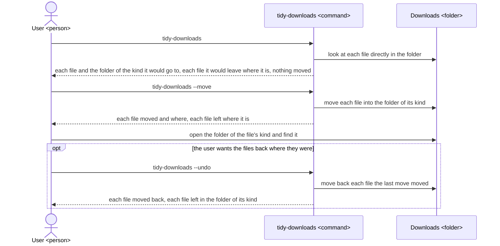
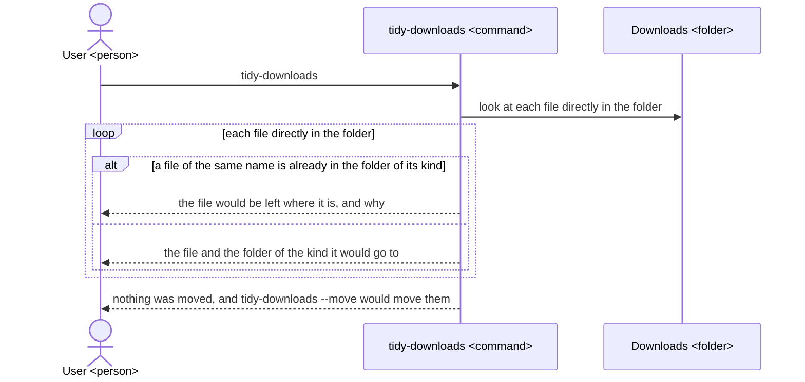
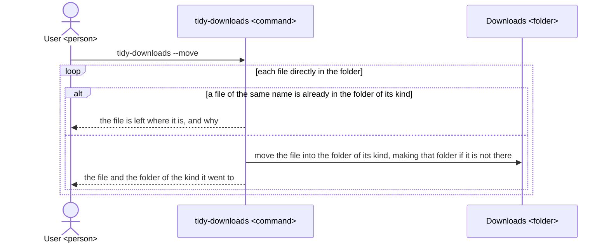
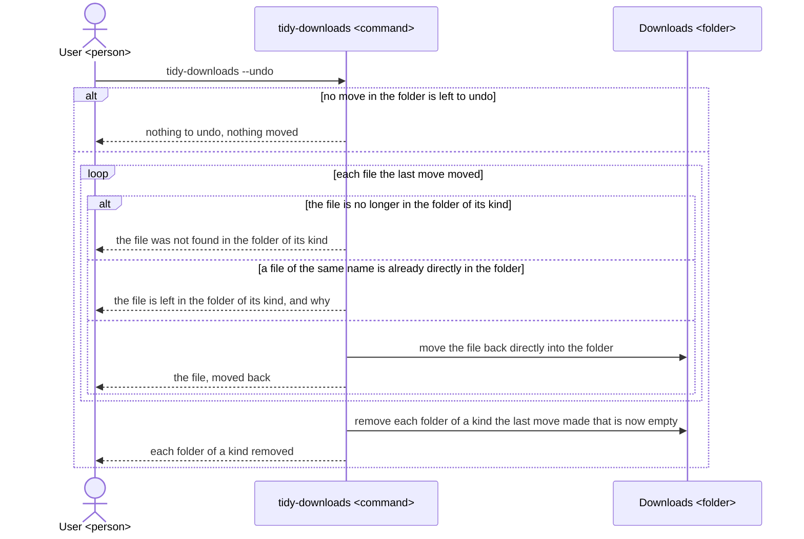

# tidy-downloads UX

tidy-downloads gives a person who runs commands in a terminal a Downloads folder sorted into a
folder for each kind of file, so that they find the file they want there, with no file lost,
renamed or changed and its last run able to be undone; the tool, its README and its architecture
are all built to this UX.

## Users and goals

- G1: A person on macOS or Linux, whose Downloads folder is cluttered with files and who runs commands in a terminal by hand, wants to find the file they want there easily.

  They run the tool themselves, when they choose to, and look for a file by opening the folder of
  its kind, a folder named for that kind, such as Images, Documents or Archives, or Other for a
  file of no known kind, such as one with no extension or an unfamiliar one; someone who never
  opens a terminal is not a user of this tool.

## Key results

They stand from the highest priority. A file lost or changed cannot be found at all, so no gain in
sorting is worth one; a file sorted into a folder the user does not look in is found late, which
costs more than one more step on the way; and a step more costs only a moment.

- KR1.1: The number of files lost, renamed or changed by a move or an undo; fewer is better, and none once G1 is reached.

  A file counts once for each move or undo after which it is no longer in the folder the tool is
  run on, directly or in the folder of a kind, under the name it had, with the content it had. A
  file the user would look for and can no longer find is one the tool has put further from them
  than before it ran.

- KR1.2: The share of the files directly in the folder the tool is run on before a move that, after it, are in the folder of the kind the user would look in for them; more is better, and all of them once G1 is reached, save each one a file of the same name keeps in place.

  Each file is judged by asking the user which of the folders of a kind they would open to find it,
  and counts when the move put it there; a file of no known kind counts when the user would look
  for it in Other. A file left in place because a file of its name is already in the folder of its
  kind counts as not there, as moving it anyway would rename or overwrite a file, which KR1.1 ranks
  above. The more files are where the user looks, the fewer they must search for.

- KR1.3: The number of steps from a terminal open at any folder, the tool installed, to the files moved; fewer is better, and once G1 is reached no step is left but seeing what would move and telling the tool to move.

  A step is one command the user types or one answer they give the tool; installing the tool is
  not counted, as it is done once. Each step is time spent and a point at which the user may leave
  the folder cluttered, so the fewer there are, the more readily they sort it whenever it fills.

## Scenes

The user is the person of G1, typing in a terminal; tidy-downloads is the command they type; the
folder is the folder the tool is run on, the Downloads folder unless the user names another, as in
`tidy-downloads ~/Desktop`, and each folder of a kind is inside it; which kinds there are is set so
that KR1.2 comes closer. A preview is a run of `tidy-downloads` alone, a move a run of
`tidy-downloads --move`, and an undo a run of `tidy-downloads --undo`. The last move is the last
move in the folder that moved a file, so a move that moved nothing leaves it as it was.

### The whole way

### Seeing what would move

### Moving

### Undoing

- Only files directly in the folder are ever moved: each subfolder, and each file in it, stays where it is, so that what the user has already sorted by hand is theirs.
- No preview, move or undo deletes, renames or overwrites a file or changes its content, so that each file is always somewhere the user can find it under its own name.
- An undo undoes only the last move, and once it is undone, that move is not undone again, so that an undo run a second time moves nothing.

## Benefits

- The user finds the file they want by opening the folder of its kind, in place of searching one long list of every file they have downloaded.

  tidy-downloads sorts every file directly in the folder into the folder of its kind in one command.

- The user sorts the folder without fear of losing a file.

  The preview shows each move before it is made, no file is ever deleted, renamed or overwritten,
  and an undo puts the files back if the user does not like the result.
