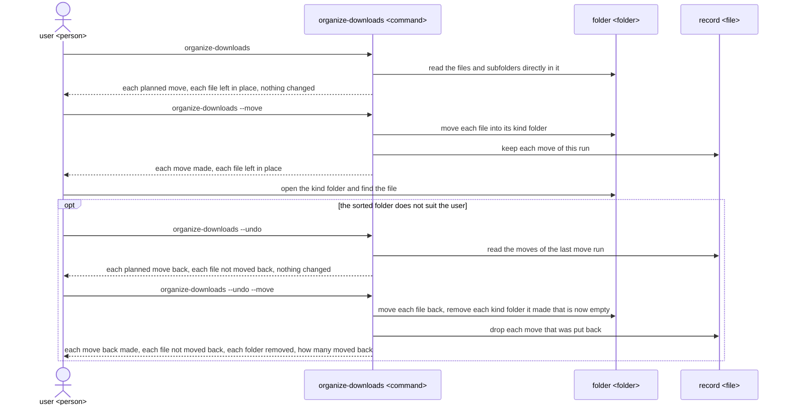
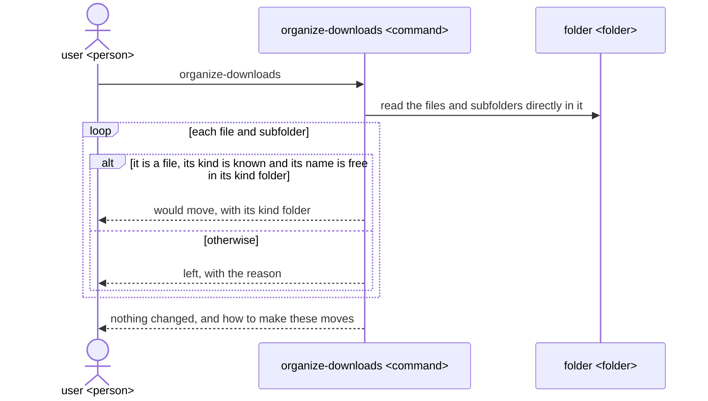
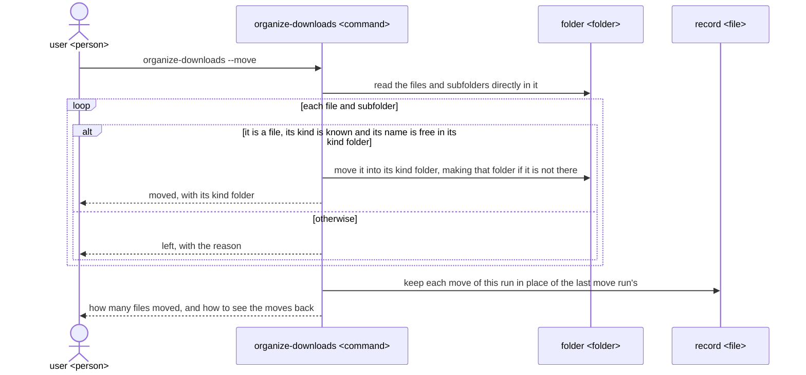
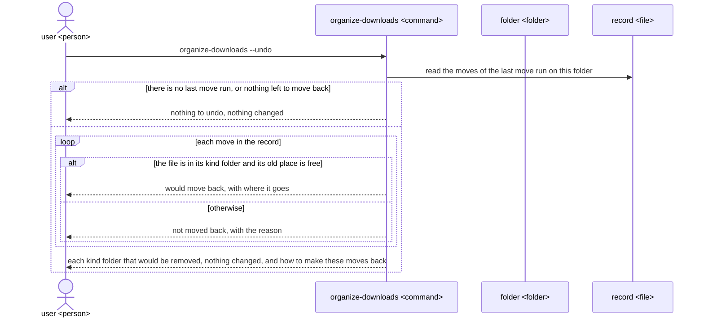
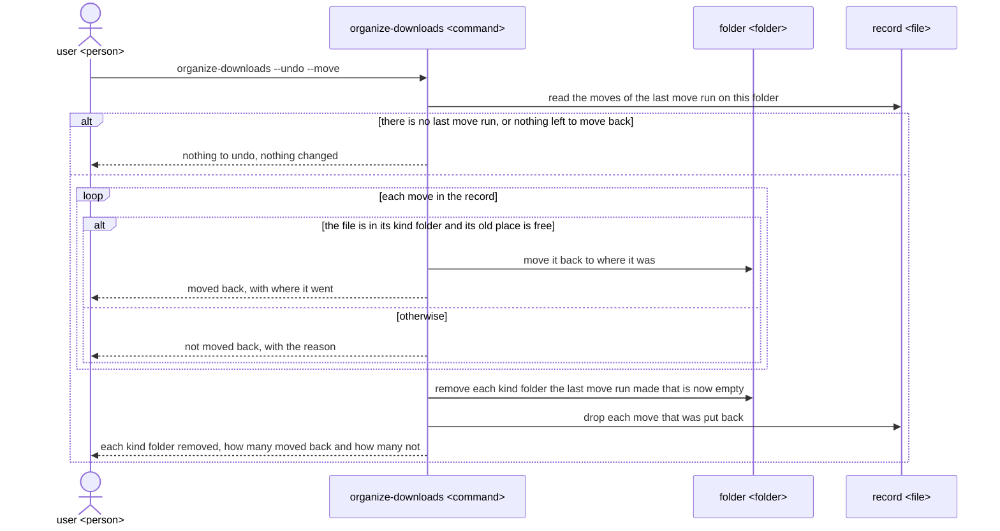

# organize-downloads UX

`organize-downloads` gives a person on macOS or Linux a Downloads folder whose files sit in one
folder for each kind of file, so they find a file by its kind, sure that no file was deleted,
renamed or overwritten, and able to move back what the last organizing moved; the README, the
architecture and the tests of the tool are all built to this UX.

## Users and goals

- G1: A person on macOS or Linux, who downloads files into a folder they cannot quickly find a file in any more, wants to find a file there by what kind of file it is, with every file still there.

  The folder is the `Downloads` folder under their home, or another folder they name in the
  command; they use a terminal well enough to type a command and read what it prints.

- G2: The same person, after organizing a folder, wants that folder back as it was before the last organizing.

  They want this when the sorted folder does not suit them, or when a program expects a file where
  it was.

## Key results

They stand from the highest priority: a lost file is the one harm the tool can do that no later run
puts right, so it comes first; sorting is G1 itself, so it comes next; the user decides to move on
what the preview shows, so a preview that matches what then happens comes after; and undo, the way
back when the user does not like the result, comes last, as the preview already lets them see the
result before it is made.

- KR1.1: The number of files, after any run, that are neither where they were before it nor where it said it moved them, with the same name and the same content; fewer is better, and once G1 is reached there are none.

  A file counts whether it was directly in the folder or in a subfolder of it, and in every kind of
  run: preview, move, undo preview and undo move. A file that is lost cannot be found by its kind
  or any other way, which is the opposite of G1.

- KR1.2: Of the files directly in the folder whose extension is in the kind table, the share that a move run puts in their kind folder; higher is better, and once G1 is reached it is every one that is not left in place with `name taken in <kind>/` or `<kind> is not a folder`.

  A file left in place for either of those reasons counts as not put, as each such file is one the
  user still has to look for among the rest; it is left there only because moving it would
  overwrite a file, and the reason shown tells the user what to clear.

- KR1.3: Of the moves a move run makes, the share that differ from what a preview run just before it, on the same folder with nothing in it changed in between, showed; fewer is better, and once G1 is reached there are none.

  A move differs when its file or its kind folder is not the one the preview showed, or when the
  preview did not show it at all; the user agrees to what they saw, so each difference is a file
  that ends up where they did not expect it.

- KR2.1: Of the files the last move run on a folder moved that are still in their kind folder and whose old place is free, the share that an undo move run puts back where they were; higher is better, and once G2 is reached it is every one.

  Each file put back is one the user finds where they left it; a file whose old place is now taken,
  or that is no longer in its kind folder, is left out of the count, as moving it back would
  overwrite a file or there is no file to move.

## Scenes

The user, a person at a terminal, types the command `organize-downloads` and reads what it prints;
the command acts on the folder, by default the `Downloads` folder under the user's home. The figures
use these words:

- A kind folder is one of `images`, `documents`, `archives`, `audio`, `video` and `installers`, directly in the folder, made by the first move run that puts a file in it.
- A preview run is a run without `--move`, which shows what a move run would do and changes nothing.
- A move run is a run with `--move`, which moves the files.
- Left in place is said of a file or a subfolder a run does not move, which it shows with the reason.
- The record is what the last move run on a folder moved, from where to where, which `--undo` reads to know what to move back.

### The whole way



- Each command takes another folder as its last word, such as `organize-downloads --move ~/Desktop`, and then acts on that folder in place of `Downloads`.

  It names the folder in the first line it prints, and every path after that is inside that
  folder, so the user sees which folder each run is about; given a folder that does not exist, it
  prints `No folder at /Users/me/Desktop.` and changes nothing.

- No run deletes, renames or overwrites a file, and no option or setting changes this.

  Where a move would need any of these, the file is left in place instead, as the scenes below
  show; this is why the user can run the tool on a folder they care about.

- The folder gains no file of the tool's; the record is kept under the user's home, in `~/.local/state/organize-downloads` on Linux and `~/Library/Application Support/organize-downloads` on macOS, one for each folder.

  The user never needs to open it or clear it.

### Seeing the planned moves



- The kind table puts each extension in one kind, read without regard to upper or lower case, so that `photo.JPG` goes to `images` like `photo.jpg`.

  | Kind folder  | Extensions |
  | ------------ | ---------- |
  | `images`     | `jpg` `jpeg` `png` `gif` `webp` `heic` `heif` `bmp` `tif` `tiff` `svg` |
  | `documents`  | `pdf` `doc` `docx` `xls` `xlsx` `ppt` `pptx` `odt` `ods` `odp` `rtf` `txt` `md` `csv` `epub` `pages` `numbers` `key` |
  | `archives`   | `zip` `tar` `gz` `tgz` `bz2` `xz` `7z` `rar` |
  | `audio`      | `mp3` `wav` `flac` `aac` `m4a` `ogg` `opus` |
  | `video`      | `mp4` `mov` `mkv` `avi` `webm` `m4v` |
  | `installers` | `dmg` `pkg` `deb` `rpm` `appimage` `exe` `msi` |

  Only the part after the last dot is the extension, so `backup.tar.gz` goes to `archives`.

- A file or subfolder is left in place for one of four reasons, each printed as shown here.

  | Case | Reason printed |
  | ---- | -------------- |
  | a file of that name is already in its kind folder | `name taken in images/` |
  | its extension is not in the kind table, or it has none, such as `setup.crdownload`, `film.part`, `app.download` or `.DS_Store` | `kind not known` |
  | it is a subfolder, kind folders included, which stays with all it holds | `subfolder` |
  | something that is not a folder already has the kind folder's name | `images is not a folder` |

- What the user sees looks like this.

  ```
  Folder: /Users/me/Downloads
  would move  report.pdf  ->  documents/report.pdf
  would move  photo.JPG  ->  images/photo.JPG
  left  song.mp3  name taken in audio/
  left  setup.crdownload  kind not known
  left  .DS_Store  kind not known
  left  audio/  subfolder
  left  projects/  subfolder
  Nothing changed. Run with --move to make these moves.
  ```

### Organizing



- A move run decides each file as the preview run does, so with the folder unchanged in between it makes the moves the preview showed and leaves the same files in place, for the same reasons.

- What the user sees looks like this.

  ```
  Folder: /Users/me/Downloads
  moved  report.pdf  ->  documents/report.pdf
  moved  photo.JPG  ->  images/photo.JPG
  left  song.mp3  name taken in audio/
  left  setup.crdownload  kind not known
  left  .DS_Store  kind not known
  left  audio/  subfolder
  left  projects/  subfolder
  Moved 2 files. Run with --undo to see how to move them back.
  ```

- A move run that moves no file still takes the place of the last move run, so a later `--undo` has nothing to move back.

  The record always holds the run the user last made, which is the one they would want to undo.

### Seeing the planned moves back



- A file is not moved back for one of two reasons, each printed as shown here.

  | Case | Reason printed |
  | ---- | -------------- |
  | a file of the same name is now where it was | `report.pdf is now in the folder` |
  | it is no longer in its kind folder under that name | `no longer in documents/` |

- A kind folder is shown as one to remove only when the last move run made it and it would hold nothing once the files are moved back.

  A kind folder that was there before that run, or that would still hold anything, stays.

- What the user sees looks like this.

  ```
  Folder: /Users/me/Downloads
  would move back  documents/report.pdf  ->  report.pdf
  not moved back  images/photo.JPG  no longer in images/
  would remove empty folder  documents/
  Nothing changed. Run with --undo --move to make these moves back.
  ```

  With no last move run on the folder, or with every move of it already put back, it prints
  `Nothing to undo in /Users/me/Downloads.` and changes nothing.

### Undoing



- The files not moved back stay in the record, so once the user clears the reason, such as by moving the other file away, `--undo --move` puts them back too.

  Once a new move run on the folder has taken the place of the last one, as under Organizing,
  they can no longer be moved back by `--undo`.

- What the user sees looks like this.

  ```
  Folder: /Users/me/Downloads
  moved back  documents/report.pdf  ->  report.pdf
  not moved back  images/photo.JPG  no longer in images/
  removed empty folder  documents/
  Moved back 1 file. 1 file not moved back.
  ```

## Benefits

- The user finds a file by opening the one folder of its kind, in place of reading through every file in the folder.

  The tool sorts by the file's extension into six kind folders that need no setup, so the files
  of one kind sit together in one folder.

- The user can organize a folder they care about without fear of losing a file.

  The rule under The whole way that no run deletes, renames or overwrites a file is the tool's
  own, with no setting to turn it off, and each file it leaves in place for that rule is shown
  with why.

- The user knows each move before it is made.

  A preview run changes nothing, and the move run after it decides each file the same way, as
  under Organizing.

- The user can go back when the sorted folder does not suit them.

  `--undo` shows first and then makes the moves back of the last move run, and takes away the
  kind folders that run made once they are empty.

- The user's folder holds only their own files and the kind folders.

  The record is kept outside the folder, under the user's home, as under The whole way.
