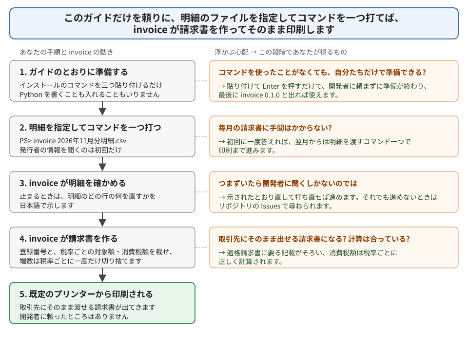

# invoice

invoice は、明細の CSV ファイルを渡すと、請求書を作ってプリンターから印刷するコマンドラインのツールです。

開発中で、いまインストールしても請求書はまだ印刷できません。

invoice は、経理チームで、取引先に出す請求書を明細のファイルから印刷するあなたのためのものです。開発者の手を借りずに、このガイドだけを頼りに、コマンド一つで請求書を印刷できます。

## できないこと

- invoice は明細を作ったり直したりしません: 販売管理や表計算ソフトから CSV で書き出した明細を渡します。

## 必要なもの

- Windows 10 か 11 のパソコンにつないだ既定のプリンター: PowerShell で `Get-CimInstance Win32_Printer -Filter "Default=True"` を打つと、その名前が出ます。

## インストール

```console
PS> # スタートで「PowerShell」と打って開き、次の行を一行ずつ貼り付けて Enter を押します。
PS> powershell -ExecutionPolicy ByPass -c "irm https://astral.sh/uv/install.ps1 | iex"
PS> # ここで PowerShell をいったん閉じて、開き直します。
PS> uv tool install https://github.com/lovaizu/playground/releases/download/invoice-v0.1.0/invoice-0.1.0-py3-none-any.whl
PS> invoice --version
invoice 0.1.0
```

最後の行に `invoice 0.1.0` と出れば、インストールできています。

## 使ってみる

最後には、取引先にそのまま渡せる適格請求書が、プリンターから一枚出てきます。

株式会社あおば事務用品の経理担当が、株式会社みなと商事への 11 月分の請求書を印刷する例です。

販売管理から書き出した明細の CSV ファイル `2026年11月分明細.csv` は、次のとおりです。

```csv
取引先,取引日,品目,数量,単位,単価(税抜),税率
株式会社みなと商事,2026-11-05,コピー用紙 A4 500枚,10,箱,2800,10%
株式会社みなと商事,2026-11-12,ドリップコーヒー 100袋入,3,箱,4500,8%
株式会社みなと商事,2026-11-20,ボールペン 黒 10本入,5,箱,1200,10%
```

明細には、取引先、取引日、品目、数量、単位、単価、税率の七つの列が要ります。

単価の見出しには、税抜なら「単価(税抜)」、税込なら「単価(税込)」と書きます。

エクスプローラーでこのファイルのあるフォルダーを開き、アドレス欄に powershell と打って Enter を押します。

開いた PowerShell で、コマンドを一つ打ちます。

```console
PS> invoice 2026年11月分明細.csv
はじめて使うので、発行者の情報を伺います。次からは聞きません。
発行者の正式名称: 株式会社あおば事務用品
登録番号(T と 13 桁の数字): T1234567890123
締め日と支払条件(例: 月末締め翌月末払い): 月末締め翌月末払い
お振込先の銀行名: さくら銀行
支店名: 本店営業部
口座種別(普通か当座): 普通
口座番号: 1234567
口座名義(カナ): カ)アオバジムヨウヒン
株式会社みなと商事 御中: 請求書番号 2026-11-001、ご請求金額 51,980 円
既定のプリンター「経理室プリンター」で 1 枚を印刷しました。
```

発行者の情報を聞くのは初回だけで、翌月からはこのコマンド一つで印刷まで進みます。

プリンターから出てくる請求書には、次のとおりに載ります。

```text
                                請求書

株式会社みなと商事 御中
                                        株式会社あおば事務用品
                                        登録番号: T1234567890123
                                        請求書番号: 2026-11-001
                                        発行日: 2026年11月30日

ご請求金額(税込): 51,980 円
お支払期限: 2026年12月31日
お振込先: さくら銀行 本店営業部 普通 1234567 カ)アオバジムヨウヒン

明細
取引日       品目                      数量    単価(税抜)  税率             金額(税抜)
2026/11/05   コピー用紙 A4 500枚       10 箱        2,800  10%                  28,000
2026/11/12   ドリップコーヒー 100袋入   3 箱        4,500  8%(軽減税率)         13,500
2026/11/20   ボールペン 黒 10本入       5 箱        1,200  10%                   6,000

税率ごとの合計
税率             対象額(税抜)   消費税額
10%                    34,000      3,400
8%(軽減税率)           13,500      1,080
合計(税込): 51,980 円
```

あなたが打ったのはコマンド一つと初回の答えだけで、開発者に頼ったところはありません。

## しくみ

このガイドだけを頼りに、明細のファイルを指定してコマンドを一つ打てば、invoice が請求書を作ってそのまま印刷します。



### コマンドを使ったことがなくても、自分たちだけで準備できる?

準備はこのガイドのコマンドを三つ貼り付けるだけで、Python を書くことも入れることもいりません。

### 毎月の請求書に手間はかからない?

発行者の情報は初回に一度答えるだけなので、翌月からは明細を渡すコマンド一つで印刷まで進みます。

### 取引先にそのまま出せる請求書になる? 計算は合っている?

invoice は登録番号と税率ごとの対象額・消費税額を載せ、消費税の端数は税率ごとに一度だけ切り捨てます。

### つまずいたら開発者に聞くしかないのでは

invoice は止まるとき、明細のどの行の何を直せばよいかを日本語で示すので、そのとおり直して打ち直せば進めます。それでも進めないときは、[Issues](https://github.com/lovaizu/playground/issues) で尋ねられます。

## ほかの資料

- [プロダクトビジョン](docs/product-vision.md): invoice が誰のために何を目指すかを知りたい人へ、その目的と測り方を示します。
- [つまずいたとき](#つまずいたら開発者に聞くしかないのでは): 印刷まで進めないときに、まず読むところです。
- [invoice の Issues](https://github.com/lovaizu/playground/issues): 直しても印刷まで進めないときに、打ったコマンドと画面に出た文を貼って尋ねるところです。

## ライセンス

invoice は社内だけで使うもので、ライセンスは付けていません。
