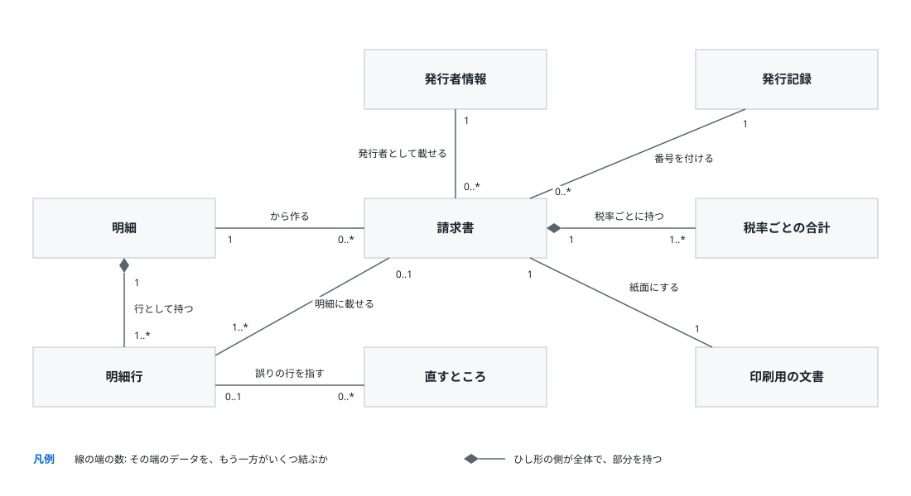
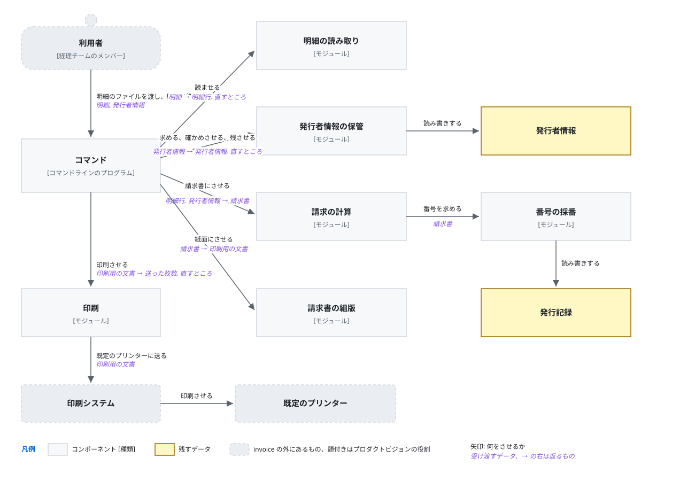
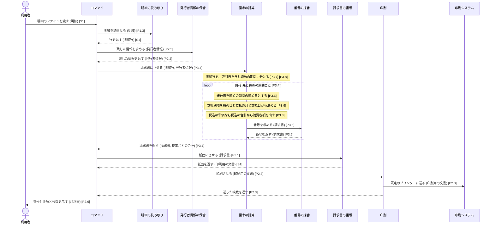
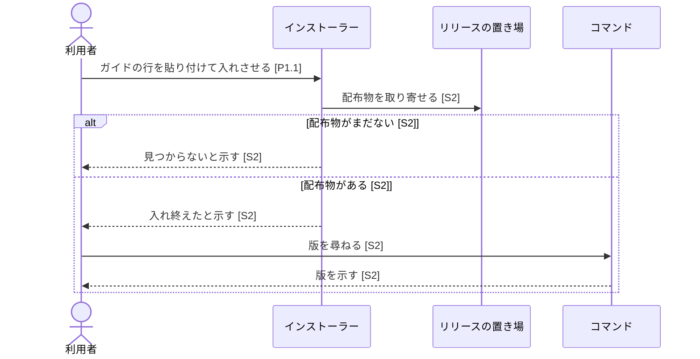
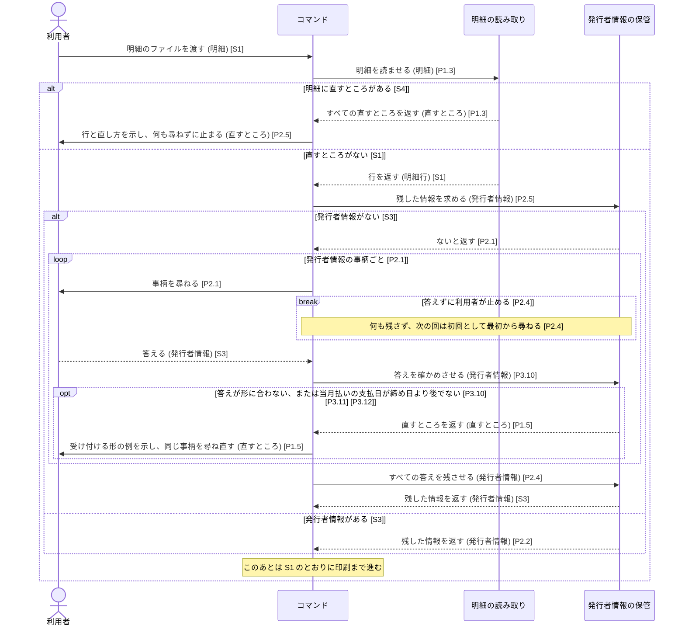
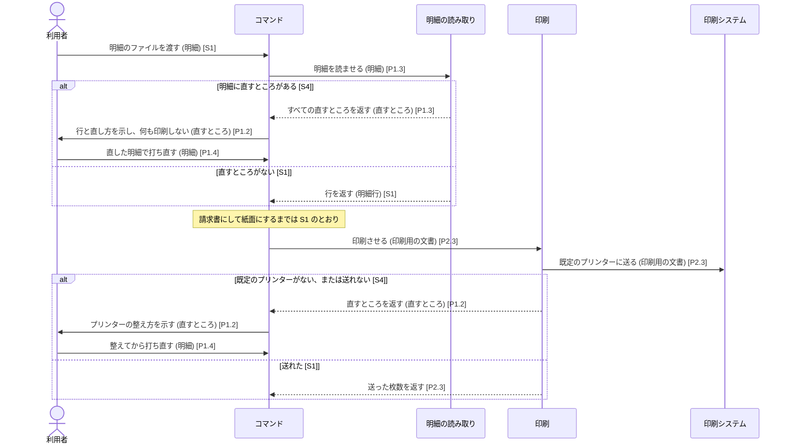
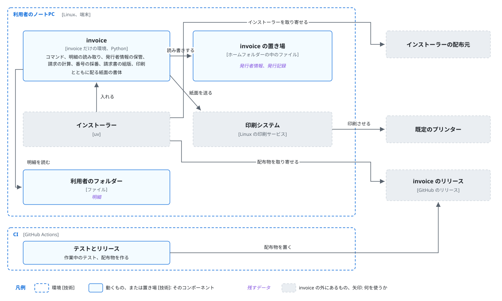

# `invoice` のアーキテクチャ

## ユーザーストーリー

- S1: 利用者は、明細のファイルから、取引先にそのまま渡せる請求書を印刷したい。
- S2: 利用者は、開発者に頼らず、自分たちだけで使い始められるようにしたい。
- S3: 利用者は、発行者の情報を一度伝えたら、毎月は伝え直さずに済ませたい。
- S4: 利用者は、つまずいたとき、何を直せばよいかを知り、自分で直して印刷まで進みたい。

## 解決の方針

### 原則

invoice は、利用者がガイドだけを頼りに、明細のファイルからコマンド一つで請求書を印刷できるようにする。

- P1: ガイドだけで足りる
  - P1.1: 準備はガイドの行を端末に貼り付けるだけで済み、利用者はプログラムを書くことも入れることもない。
  - P1.2: invoice は止まるとき、明細のどの行の何をどう直せばよいかを、日本語で示す。
  - P1.3: invoice は直すところを一度にすべて示し、そのときは一枚も印刷しない。
  - P1.4: 直して同じコマンドを打ち直せば、はじめから正しく打ったときと同じ請求書が出る。
  - P1.5: 発行者の情報の答えが形に合わないときは、受け付ける形の例を示して、同じ事柄を尋ね直す。
- P2: コマンド一つ
  - P2.1: 発行者の情報は、初回に一度だけ尋ねる。
  - P2.2: 二回目からは、明細のファイルを渡すだけで、何も尋ねずに印刷まで進む。
  - P2.3: 請求書は、既定のプリンターで印刷する。
  - P2.4: 発行者の情報は、すべての答えがそろったときにだけ残す。
  - P2.5: 初回も、明細に直すところがないと分かってから、発行者の情報を尋ねる。
  - P2.6: 印刷を頼み終えたら、請求書ごとの番号と金額と、印刷した枚数を画面に示す。
- P3: 取引先にそのまま出せる
  - P3.1: 請求書には、適格請求書に要る事項を、登録番号と税率ごとの対象額と消費税額まで載せる。
  - P3.2: 消費税の端数は、請求書一枚につき、税率ごとに一度だけ切り捨てる。
  - P3.3: 単価が税込の明細では、税率ごとの税込の合計から消費税額を出す。
  - P3.4: 請求書は、明細の取引先と締めの期間ごとに一枚ずつ作る。
  - P3.5: 同じ取引先の同じ期間の請求書は、何度印刷しても同じ請求書番号になる。
  - P3.6: 発行日は、その請求書の締めの期間の締め日とする。
  - P3.7: 締めの期間は、前の締め日の翌日から次の締め日までとする。
  - P3.8: 明細の各行は、その取引日を含む締めの期間の請求書に載せる。
  - P3.9: 支払期限は、締め日のある月から、支払条件の当月、翌月、翌々月のとおりに進めた月の支払日とする。
  - P3.10: 支払条件は、締め日、当月か翌月か翌々月、支払日を並べた「20日締め翌月10日払い」の形でだけ受け付ける。
  - P3.11: 当月払いの支払条件は、支払日が締め日より後の日のときだけ受け付ける。
  - P3.12: 締め日と支払日は、1 日から 28 日か月末のどれかとする。

### データモデル



- 明細\
  請求の元になる取引を、一行に一つずつ並べたファイルである。
- 明細行\
  一つの取引を表し、請求書の明細の一行になる。
- 直すところ\
  invoice が止まるわけと、その直し方を表し、明細の誤りなら、その行を指す。
- 発行者情報\
  請求書を出す側として毎回載せる事柄と支払条件を、次の請求でも使えるように保つ。
- 請求書\
  一つの取引先の一つの締めの期間について、請求する額とその内訳を表す。
- 税率ごとの合計\
  一枚の請求書の中の一つの税率について、対象額と消費税額をまとめる。
- 発行記録\
  付けた請求書番号を取引先と締めの期間ごとに保ち、同じ請求書に同じ番号を付け直させる。
- 印刷用の文書\
  請求書を用紙の上に配置したもので、プリンターへそのまま渡せる。

方針:

- 発行者情報と発行記録は、invoice を使い終えたあとも残し、次に使うときに読み直す。[P2.2]\
  意図: 毎月の請求で、同じことを尋ね直さないため。
- 発行者情報は、すべての答えがそろったときに一度に書き、途中で止まれば何も残さない。[P2.4]\
  意図: 事柄の欠けた発行者情報で、請求書を作らないため。
- 発行者情報は、支払条件を、締め日、支払の月、支払日の三つの値で保つ。[P3.9]\
  意図: 読み書きする部品が、同じ支払条件を同じ意味に受け取るため。
- 発行記録は、取引先と締めの期間の組ごとに、番号を一つだけ保つ。[P3.5]\
  意図: 印刷し直した請求書を、取引先が別の請求と取り違えないため。
- 金額は円の整数で持ち、端数は税率ごとの合計でだけ切り捨てる。[P3.2]\
  意図: 計算の途中で、丸めによる一円の違いが入らないため。

### コンポーネント



- コマンド (コマンドラインのプログラム)\
  一つのコマンドで、明細のファイルから請求書の印刷までを利用者に通す。
- 明細の読み取り (モジュール)\
  明細が請求書にできる形かを決め、できないところを直し方とともに返す。
- 発行者情報の保管 (モジュール)\
  発行者情報の形を決め、一度答えた情報を次の請求でもそのまま使えるように保つ。
- 請求の計算 (モジュール)\
  明細行から、取引先と期間ごとの請求書の額を、適格請求書として正しく決める。
- 番号の採番 (モジュール)\
  同じ請求書にはいつも同じ番号を、別の請求書には別の番号を付ける。
- 請求書の組版 (モジュール)\
  請求書を、取引先にそのまま渡せる紙面にする。
- 印刷 (モジュール)\
  紙面を既定のプリンターに届け、届かないときはそのわけを直し方とともに返す。

方針:

- 利用者と言葉を交わすのはコマンドだけで、ほかの部品は結果か直すところを返す。[P1.2]\
  意図: 利用者に示す日本語を一か所でそろえ、どこで止まっても同じ形で直し方を伝えるため。
- 明細の読み取りは、印刷の前に明細のすべての行を読み、直すところをまとめて返す。[P1.3]\
  意図: 一度の直しと打ち直しで、印刷まで進めるため。
- 支払条件の答えを読み取るのは発行者情報の保管だけで、請求の計算は読み取った値から期間と期限を決める。[P3.10]\
  意図: 答えの書き方によらず、同じ支払条件からは同じ期間と期限の請求書が出るため。
- 請求書の額は請求の計算だけが決め、組版は決まった額をそのまま載せる。[P3.1]\
  意図: 画面に示す金額と紙に載る金額が、食い違わないため。
- 番号の採番は請求の計算と分けた部品とし、発行記録を読み書きするのは番号の採番だけとする。[P3.5]\
  意図: 額の決め方を変えても、同じ請求書に付く番号が変わらないため。
- 印刷システムに触れるのは印刷だけとする。[P2.3]\
  意図: プリンターのないところでも、ほかの部品をすべて確かめられるようにするため。

### シーケンス

#### S1: 明細から請求書を印刷する



#### S2: 自分たちだけで使い始める



#### S3: 発行者の情報を一度だけ伝える



#### S4: つまずいても自分で直して進む



方針:

- どの道筋でも、コマンドはまず明細を読ませ、直すところがないときにだけ発行者情報と印刷に進む。[P2.5]\
  意図: 明細に誤りがあるとき、問いに答えたり用紙を使ったりする前に、利用者がそれを知って直せるようにするため。
- 打ち直しでは、番号の採番が前と同じ番号を返し、請求書は前と同じ中身で出る。[P1.4]\
  意図: 止まる前に番号を付けた請求書も、番号を飛ばさず出し直せるようにするため。

### デプロイ



利用者が端末で明細のファイルを指定して invoice を打つと始まり、印刷を頼み終えると止まる。

方針:

- invoice は、インストーラーが用意する invoice だけの環境に入れる。[P1.1]\
  意図: 利用者がプログラムの道具を入れたり整えたりせずに済むため。
- 紙面に使う書体は invoice とともに配り、ノートPCの書体に頼らない。[P1.1]\
  意図: どのノートPCでも、同じ紙面の請求書が出るため。
- 発行者情報と発行記録は、利用者のホームフォルダーの中の invoice の置き場に残す。[P2.2]\
  意図: どのフォルダーで打っても、同じ発行者情報と番号を使うため。
- 印刷は、ノートPCの印刷システムに既定のプリンターで頼む。[P2.3]\
  意図: ガイドの必要なものにある既定のプリンターのほかに、何も整えずに済むため。
- 配布物は、CI がすべての作業中のテストを通したものだけをリリースに置く。[S2]\
  意図: 利用者が入れる版が、いつも確かめ終えたものであるため。

### ディレクトリ構成

```text
.github/workflows/invoice.yml  invoice のテストとリリースを CI で動かす
invoice/                       invoice の一式
  README.md                    利用者のガイド
  pyproject.toml               配布物の名前と版と、コマンドの入口
  docs/                        開発者と利用者の資料
    product-vision.md
    architecture.md
    images/
  images/                      ガイドの図
  src/invoice/                 利用者に配る invoice の本体
    command.py                 コマンド
    ledger.py                  明細の読み取り
    issuer.py                  発行者情報の保管
    billing.py                 請求の計算
    numbering.py               番号の採番
    layout.py                  請求書の組版
    printing.py                印刷
    fonts/                     紙面に使う書体
  tests/                       テスト
    unit/
    integration/
    e2e/
```

方針:

- invoice の本体には、コンポーネントごとに一つのファイルを置く。[S1]\
  意図: 部品の決めごとを変える開発者が、手を入れるファイルを一つに決められるため。
- 紙面に使う書体は、invoice の本体の中に置き、配布物に含める。[P1.1]\
  意図: 利用者が invoice を入れるだけで、書体もそろうため。
- テストは、テスト戦略の段ごとに、単体、結合、E2E のフォルダーに分ける。[S2]\
  意図: 変更ごとに待つテストを、時間のかかるプロダクト全体のテストと分けて回せるため。
- 利用者のガイドとその図は invoice の一式の直下に置き、開発者の資料は docs に分ける。[P1.1]\
  意図: 利用者が開くガイドを、利用者の言葉だけで保つため。

## テスト戦略

| 確かめること | テストの対象 | 種類 | いつ | 合格の基準または測るもの |
|---|---|---|---|---|
| リント | 単体テストで確かめる部品 | 品質 | 作業中 | 指摘が 0 件 |
| 静的解析 | 単体テストで確かめる部品 | 品質 | 作業中 | 指摘が 0 件 |
| 複雑度の解析 | 単体テストで確かめる部品 | 品質 | 作業中 | 関数ごとの各上限が、確かめる道具の既定値に収まる |
| 単体テスト | 単体テストで確かめる部品 | 品質 | 作業中 | すべてのケースが通る |
| コードカバレッジ | 単体テストで確かめる部品 | 品質 | 作業中 | 命令網羅と分岐網羅がともに 100% |
| プロパティベーステスト | 単体テストで確かめる部品 | 品質 | 作業中 | 消費税の端数と合計の決まり、締めの期間と支払期限の決まりに、反例が 0 件 |
| データ互換性テスト | 単体テストで確かめる部品 | 品質 | 作業中 | 表計算ソフトが書き出した明細と、前の版が残した発行者情報と発行記録を、欠けなく読む |
| 結合テスト | 結合テストで確かめるアーキテクチャ | 品質 | 作業中 | すべてのケースが通る |
| 信頼性テスト | 結合テストで確かめるアーキテクチャ | 品質 | 作業中 | 尋ねる途中、番号を残す途中、印刷の途中で止まっても、発行者情報と発行記録を失わない |
| 契約テスト | 結合テストで確かめるアーキテクチャ | 品質 | 作業とは別、印刷システムの新しい版は別の予定で来るため | 記録した各手順で、本物の印刷システムが代役と同じ結果を返す |
| トレーサビリティ | 結合テストで確かめるアーキテクチャ | 品質 | 作業中 | 要素ごとに結合テストがあり、どのテストも一つ上の段の要素かケースを名指しし、不備が 0 件 |
| シナリオテスト | E2E テストで確かめるプロダクト | 品質 | 段階ごと | すべてのケースが通る |
| インストールテスト | E2E テストで確かめるプロダクト | 品質 | 段階ごと | ガイドのコマンドで、まっさらなノートPCに入れ、更新し、外せる |
| 適合性テスト | E2E テストで確かめるプロダクト | 品質 | 段階ごと | 印刷した請求書に、適格請求書の記載事項と端数の決まりへの不備が 0 件 |
| ユーザビリティテスト | E2E テストで確かめるプロダクト | ベンチマーク | 作業とは別、経理チームの予定に合わせるため | ガイドだけで印刷まで進めた人の割合と、明細を手にしてから印刷までの時間で、人数は一人足しても結果が変わらなくなるまで足す |
| アルファ・ベータテスト | E2E テストで確かめるプロダクト | ベンチマーク | 作業とは別、毎月の請求の予定に合わせるため | 実際の毎月の請求で、開発者の手を借りた回の割合と、そのわけ |
