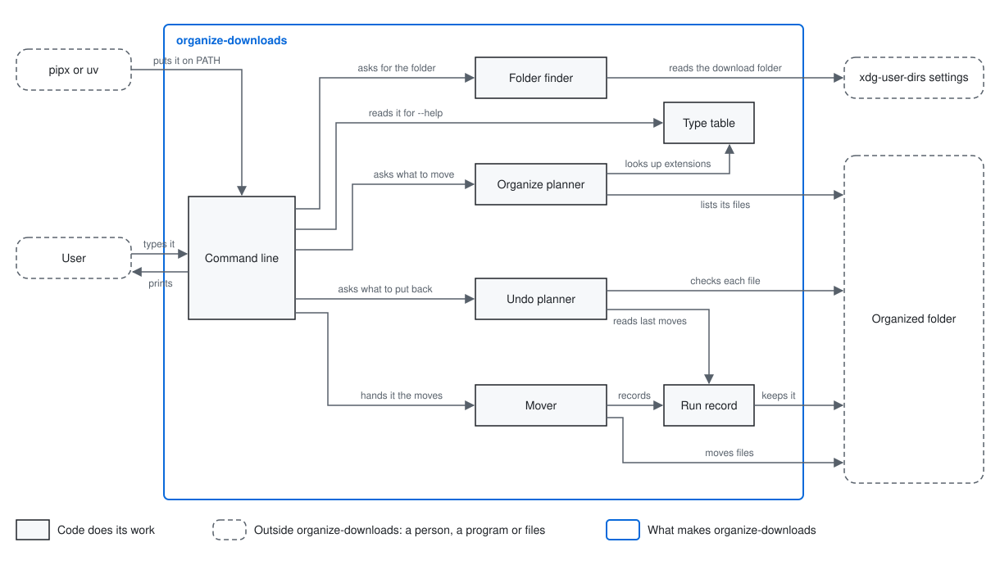

# organize-downloads architecture

organize-downloads is one Python script in which a Planner decides, for each file directly in a
folder, the kind's folder it goes to or why it stays, a Mover carries out that plan while a Record
keeper keeps each move outside the folder, and an Undoer puts back the files of the folder's last
move, the last run that moved a file in it; what it does for the user, and the words it uses such
as a kind's folder, are defined in the [README](../README.md).

It is built on no other product's architecture, so its principles are its own:

- No file is ever deleted, renamed or overwritten: a file is only moved, under its own name, to a
  place that holds no file of that name.

- Only the files directly in the folder are moved; every folder in it, and all it holds, stays as
  it is, apart from the kinds' folders the tool fills and empties.

- Nothing is added inside the folder but the kinds' folders, so whatever the tool needs to keep is
  kept outside it.

- Where each file goes is decided in one place, so a run that moves nothing shows what the run
  that moves will do.

- Installing the tool is downloading one file, with nothing to install beside it.

## User stories

- As a user, I want to see, for each file in my Downloads folder or another folder, the kind's
  folder it would move to or why it stays, with nothing moved.
- As a user, I want to move each file in that folder into its kind's folder.
- As a user, I want to put back the files the last move in that folder took.
- As a user, I want to see how to run the tool.

## Architecture

### Logical view



- To list, the Command line asks the Planner where each file goes, which the Planner tells from
  the names in the folder and in its kinds' folders, and prints a line for each; to move, it hands
  that same plan to the Mover and prints a line for what became of each file; to undo, it asks the
  Undoer and prints a line for each file of the last move; asked for help, it prints how to run
  the tool.

- The Mover makes a kind's folder where it is missing and moves each file there, and has the Record
  keeper add each file moved to the folder's record as soon as it is moved, with the kind's folder
  it made if this is the first file in it, the first file moved in a run starting that record anew.

  Why: a run stopped half way, by an error or by the user, leaves a record of every move it did
  make, so those can still be undone; and a run that moves nothing leaves the record of the last
  move as it was, so an undo after it still puts back the files of the last move.

- The Mover moves a file by giving it its new name as a hard link, a second name for the same file
  and its contents, and then removing the old name, never by a rename.

  Why: a rename replaces a file that came to hold that name after the Planner looked, while making
  a hard link to a taken name fails and leaves both files as they were, so the principle of never
  overwriting holds even then.

- On a drive that cannot make hard links, such as a USB stick formatted FAT or exFAT, the Mover
  instead makes the new name as a new file, which fails where the name is taken, copies the
  contents into it and then removes the old name, or, where the copy fails, removes the new file
  and leaves the old one where it was.

  Why: the user can then sort any folder the README lets them name, the new name is still never
  one that was taken, and a copy that fails, such as on a full drive, adds no file, so the
  principles hold there too.

- The Undoer reads the folder's last move through the Record keeper, puts the files back by the
  same kind of move as the Mover's, and removes the kinds' folders only once the files are back.

  Why: a kind's folder the last move made is left empty only when its files have gone back.

- The Record keeper keeps one record for each folder, so a move or an undo in one folder never
  reads or replaces another folder's record.

### Physical view

```
organize-downloads/                  <the tool's folder in the repository>
├── organize-downloads               <Python 3 script, standard library only: Command line, Planner, Mover, Record keeper, Undoer>
└── tests/                           <Python unittest tests>
    ├── test_<component>.py          <the tests of one component>
    └── test_stories.py              <the tests of the user stories>
~/.local/bin/organize-downloads      <the script, downloaded there as the README says>
~/.local/state/organize-downloads/   <the Record keeper's folder on Linux; ~/Library/Application Support/organize-downloads/ on macOS>
└── <hash of the folder's path>.jsonl <JSON Lines: the record of one folder's last move, a file moved on each line, with the kind's folder made for it>
```

- The tool depends on nothing but Python and its standard library, in the version the README's
  Requirements give, and the user starts it by running `organize-downloads`, which the script's
  first line hands to `python3`.

- The record of a folder is named by a hash of the folder's full path, and holds that path.

  Why: a name made from the path itself can be longer than a file name may be, while a hash is
  always short and the path inside tells which folder it is for.

- The tool finds `~/Downloads` and the Record keeper's folder from the user's home folder alone,
  and chooses the macOS place or the Linux place by the system it runs on.

## Test

The project has no rules for how its parts and its user stories are checked, so this section gives
what this tool's checks need.

- Each component of the script is checked by tests written with Python's own unittest, each a
  Given, a When and a Then, that load the script as a module and call the component.

  Why: unittest comes with Python, so the tests need nothing installed beyond what the tool
  itself needs.

- Each user story is checked by running the script as the user does, on a temporary test folder
  holding a file of every case, with the home folder set to a temporary one.

  Why: run so, the tests reach `~/Downloads` and the record's place without touching the user's
  own files.

- All the tests are run by one command from the repository's root, and pass on Linux:
  `python3 -m unittest discover organize-downloads/tests`.

- On macOS, the user stories are checked by the user running the tool once on a test folder there.
