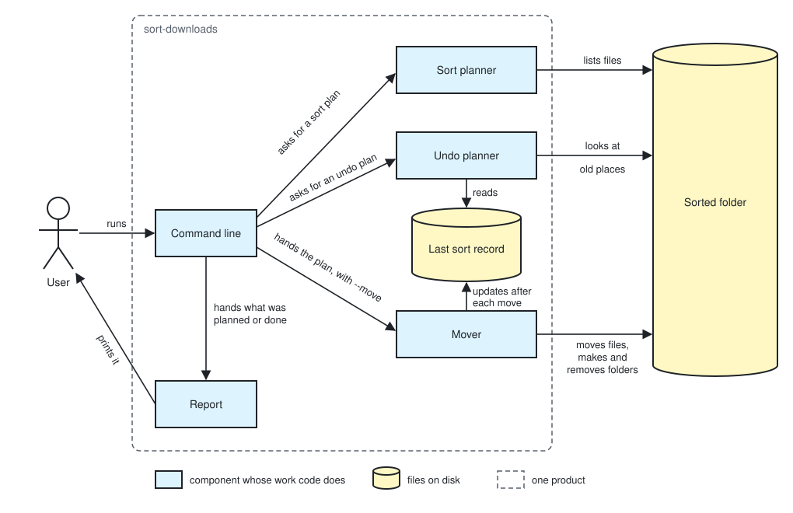

# sort-downloads architecture

sort-downloads is one Python program that first makes a plan of every move a run would make, a
sort or an undo, and then either prints the plan or carries it out and prints what it did, keeping
a record of the last sort outside the folder it sorted. What the user does with it and sees is
defined in [the README](../README.md).

- Nothing is moved unless the run is given `--move`; without it the tool only reads.
- No file is deleted, renamed or written over; the one thing the tool removes is an empty folder that the sort being undone made.
- A sort moves only the files directly in the folder it sorts, never a folder or anything inside one, and an undo moves only the files that sort moved.
- What a run prints before `--move` and what it does with `--move` come from the same plan, so a run never does what its preview did not show.

  The user decides from the preview, so a second way of deciding moves would let the two differ.

- At run time the tool needs only Python 3.9 or newer and its standard library.

  This is all the README's Requirements ask the user to have.

## User stories

- As the user, I want to see, for my Downloads or a folder I name, which folder each file lying loose in it would move to and which files would be left and why, with nothing moved.
- As the user, I want to move the files lying loose in my Downloads, or in a folder I name, into folders by their kind.
- As the user, I want to see which files undoing my last sort would move back and which it would leave and why, with nothing moved.
- As the user, I want to undo my last sort, putting each file it moved back and removing the folders it made once they are empty.
- As the user, I want to see every option the tool takes.
- As the user, I want to install the tool on Linux or macOS from a clone of the repository.

## Architecture

### Logical view



- A run goes in this order: the user runs the Command line; it asks the Sort planner, or with `--undo` the Undo planner, for a plan; with `--move` it hands the plan to the Mover; last it hands the plan, or what the Mover did, to the Report, which prints it.
- A plan is the list of moves a run would make, each a file and the place it would go, and of files left, each with its reason, and for an undo also of the folders to remove once empty.
- The Command line checks the options and the folder where they come in, uses `~/Downloads` where no folder is named, and stops with what to do instead where they cannot be used; `--help` is printed by it and goes no further.
- The Sort planner lists the files directly in the folder and gives each the folder of its kind, by the kinds and endings it holds, or a reason to leave it: hidden, still downloading, or its name taken in the folder it would go to.
- The Undo planner reads the Last sort record and gives each file the sort moved the place it would go back to, or a reason to leave it, such as its old place now holding a file of the same name.
- The Mover makes each move one at a time, by a step that fails where the target name is taken rather than by looking first, and a file whose move fails so is left where it is, with that reason.

  A file the user saves between the plan and the move is then never written over.

- The Mover makes each kind folder that is not there, and on an undo removes a folder by a step that fails where the folder still holds anything.
- On a sort the Mover first replaces the Last sort record with an empty one for that folder, then writes each move and each folder it made into it as soon as it is made.

  A sort cut off part way can then still be undone for the moves it made.

- On an undo the Mover takes each file it moved back, and each folder it removed, out of the record, so the record always holds what is still to undo.

  A file left because its old place was taken can be moved back by a later undo once the user clears that place.

- The Last sort record is kept outside the sorted folder.

  The undo names no folder, so the record must be found without one, and it is not then a file in the folder for a sort to see.

- Installing takes no component: it is copying the one program file the physical view places, as the README's Installation says.

### Physical view

```text
sort-downloads/                     the tool's folder in the repository
├── sort_downloads.py               <Python 3.9, standard library only>: Command line, Sort planner, Undo planner, Mover, Report
├── sort-downloads                  <symbolic link to sort_downloads.py>: the name the user copies and runs
├── tests/
│   ├── test_*.py                   <Python 3.9, unittest>: the unit tests
│   └── properties.py               <Python 3.9, unittest and Hypothesis>: the property tests
├── pyproject.toml                  <TOML>: the settings of the development tools
├── README.md
└── docs/
    ├── architecture.md
    └── logical-view.svg
$XDG_STATE_HOME/sort-downloads/     on the user's machine, ~/.local/state/sort-downloads/ where XDG_STATE_HOME is not set
└── last-sort.json                  <JSON>: the Last sort record
```

- The one thing the tool depends on outside itself is `python3`, version 3.9 or newer, found by the program's first line, `#!/usr/bin/env python3`.
- The user starts it by the name `sort-downloads`, from the copy the README's Installation puts in `~/.local/bin`; `cp` copies the file the link points to.

  The code is in a file named like a Python module so the tests and the development tools take it as one, and the link gives the user a command name with no `.py`.

- The record is written as a new file and then put in the place of the old one, so it is never left half written.
- The development tools, used to check the tool and never by the user, are [Hypothesis](https://hypothesis.readthedocs.io/), [coverage.py](https://coverage.readthedocs.io/), [mutmut](https://mutmut.readthedocs.io/) with [pytest](https://docs.pytest.org/), which runs the unittest tests for it, [Ruff](https://docs.astral.sh/ruff/) and [mypy](https://mypy.readthedocs.io/).

## Test

The project has no rules of its own for checking code and user stories, so the checks of this tool
are set here.

- The code is checked by unit tests written with unittest, run by `python3 -m unittest` on Python 3.9 with nothing installed.

  They then show that the tool works with only what the README asks the user to have.

- The unit tests run the program's functions on folders made for each test in a temporary folder, with `HOME` and `XDG_STATE_HOME` pointed into it.

  No test then reads or moves the files of the machine it runs on, or another test's record.

- A unit test checks the README's table of kinds and endings against the kinds the Sort planner holds.

  The kinds are written in the code and shown in the README, and this keeps the two the same.

- Property tests, each run on many inputs Hypothesis makes, check over any file names that a sort followed by its undo leaves every file where it was with the same name and content, and that no run writes over a file.
- The property tests are in `tests/properties.py`, a name outside the `test*.py` that `python3 -m unittest` finds, and are run on their own by `python3 -m unittest tests.properties` with Hypothesis installed.

  The unit test run, and the coverage counted over it, then never meet Hypothesis, which the user does not have.
- Every change passes the unit tests with their coverage of lines and branches counted by coverage.py, Ruff's formatter and linter, and mypy, each with its settings in `pyproject.toml`.
- The property tests, and mutation testing with mutmut, which makes small changes to the code and finds a test failing on each, are run on what a change touches before the change is merged.
- The user stories are checked by real runs of the installed `sort-downloads` on Linux, on a new copy of the trial folder that [AC4 of the plan](../../.rn/20261027-organize-downloads-cli/steering.md#acceptance-criteria) names for each run.
- AC1 is checked by `sort-downloads <trial folder>`, with every file's name, place and checksum read before and after.
- AC2 and AC3 are checked by `sort-downloads --move <trial folder>`, with the same read before and after.
- AC8 is checked by `sort-downloads --undo` and then `sort-downloads --undo --move`, run after a sort and after a new file is put where one the sort moved was.
- The run with no folder named is checked by `sort-downloads` with `HOME` set to a temporary folder whose `Downloads` is the trial folder.
- Installing on a Mac, and the kinds suiting the user's own Downloads, are checked by the user, as AC5 and AC6 of the plan say.
